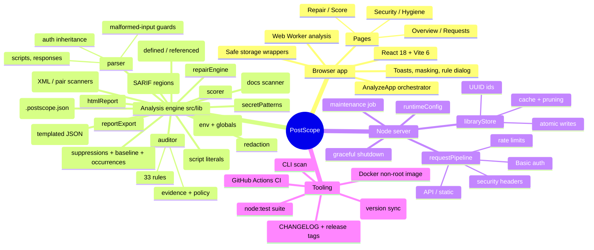
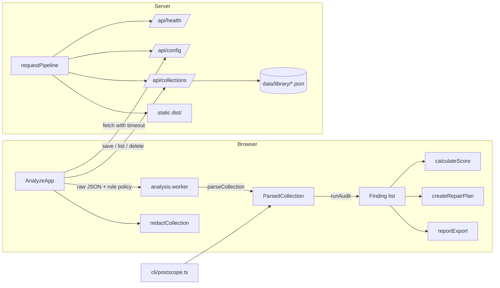

# PostScope: Technical Mindmap

> **Audience:** engineers changing PostScope's code, deployment, or security posture.
> **Companion:** [FUNCTIONAL_MINDMAP.md](FUNCTIONAL_MINDMAP.md) describes *what* the product does. [../ARCHITECTURE.md](../ARCHITECTURE.md) is the shorter architecture reference; [../SECURITY.md](../SECURITY.md) is the threat model.
> **Scope:** reflects the code after release V0.1.25. Each release updates the sections it touches and adds a line to section 10.

---

## Overview

---

## 1. Repository layout

| Path | Contents |
|---|---|
| `src/lib/` | Framework-free analysis engine shared by the browser, the server, and the CLI |
| `src/workers/analysis.worker.ts` | Web Worker entry: `JSON.parse` → `parseCollection` → `runAudit` |
| `src/pages/`, `src/components/` | React UI (pages, layout, shadcn-style primitives in `components/ui`) |
| `server/` | Node HTTP server and Vite dev/preview middleware |
| `cli/postscope.ts` | CI scanner |
| `tests/` | `node:test` suites run through `tsx` (`npm test`) |
| `scripts/` | Demo collection generator, test runner, `release-check.mjs` |
| `public/samples/` | Bundled sample collections |
| `docs/` | Architecture, deployment, security, design system, mindmaps |
| `mindmap/ROADMAP.md` | Release plan and conventions (one commit per version) |
| `CHANGELOG.md` | Shipped changes per version, newest first |

## 2. Analysis engine (`src/lib`)

All modules are pure TypeScript with relative imports only, so the same code runs in the browser, the Web Worker, Node (server redaction and policy), and the CLI.

### 2.1 Parser (`parser.ts`)

`parseCollection(json) → ParsedCollection`

| Concern | Behavior |
|---|---|
| Validation | Throws `Invalid Postman collection format` unless the root is an object with an `item` array |
| Malformed items | Non-object items, non-array folders, and nesting deeper than 100 levels are skipped and reported in `parseWarnings` (max 25) |
| Request IDs | Unchanged historical scheme: `folder/path/name`, duplicates suffixed `#2`, `#3`, … Findings and the repair engine key on these |
| Auth inheritance | Effective auth = request auth → nearest folder auth → collection auth (`inherit` / missing = defer). Exposes `auth`, `authSource`, `authOwnerPath`, `authFields`, `basicAuth` |
| Auth owners | Collection- and folder-level auth definitions in `authOwners` so leaks are found even when no request inherits them |
| Headers | Array form or raw `Key: value` string block; non-string values coerced. Disabled headers are kept separately in `disabledHeaders` (active `headers` is unchanged for existing consumers) |
| URLs | String or object form; `path` segments may be strings or `{ value }` objects; query from `url.query` (disabled entries go to `disabledQueryParams`) or parsed from raw |
| Bodies | Mode-aware: raw, urlencoded and form-data fields (`bodyFields`, file fields skipped; disabled fields in `disabledBodyFields`), GraphQL query + variables |
| Scripts | Request `event[]` → `scripts.prerequest/test` (disabled events in `scripts.disabledPrerequest/disabledTest`); collection/folder events → `ParsedCollection.scripts` with `disabled: true` when switched off |
| Saved responses | Up to 50 per request; headers, body (first 64 KB), original request headers (`disabledRequestHeaders` for disabled ones)/URL/query (`requestQuery`)/body (`requestBody`, 64 KB)/auth |
| TLS | `protocolProfileBehavior.strictSSL` inherited collection → folder → request (`tlsVerificationDisabled`) |
| Environments | `environment.ts`: `parseEnvironment` reads `values[]` of `*.postman_environment.json` / `*.postman_globals.json` (kind from `_postman_variable_scope` or the file name). `attachEnvironments` adds `ParsedCollection.environments` and `activeEnvironment` (unreadable files become parse warnings). `lookupVariableValue` resolves a key by selected environment, then collection, then globals |
| Descriptions | Collection `info.description`, folder and request descriptions (string or `{ content }`, 64 KB each) in `ParsedCollection.descriptions` with owner, item path and request id |
| Scoped variables | Folder and request `variable[]` in `ParsedCollection.scopedVariables` (scope, owner, item path) |
| Path variables | `url.variable[]` in `ParsedRequest.pathVariables` |
| Variables | `variables.ts`: names may contain dashes/dots/spaces; `{{$dynamic}}` names excluded |

### 2.2 Rule engine (`auditor.ts`, `rules.ts`, `severity.ts`)

- `rules.ts` is the registry: id, title, description, recommendation, default severity, category, CWE, OWASP. Titles of the original rules are unchanged.
- `runAudit(parsed, options?)` feeds a `FindingCollector`: each rule records affected request IDs and **masked evidence** (`{ requestId?, location, preview }`, de-duplicated, max 100 per finding).
- `build(options)` applies `disabledRules` and `severityOverrides`, then sorts by severity (stable, registry order).
- `Finding.id === Finding.ruleId`: stable and unique per run (the old `Date.now()` suffix was removed).
- `sanitizeAuditOptions` normalizes untrusted policy input (localStorage, server env).
- `KNOWN_SECRET_PATTERN` only reports requests no keyword rule already flagged, to avoid double counting.
- **Disabled entries** (Postman keeps them in the export) go through the same secret rules as active ones; evidence locations end with ` (disabled)`. `MISSING_AUTH`, `EMPTY_HEADERS` and the other hygiene checks only look at active entries, so a disabled `Authorization` header never counts as protection.
- **Variable integrity** (`variableUsage.ts`, `checkVariableIntegrity`): `analyzeVariableUsage` collects references per request and place (URL, headers, path variables, body, auth, `pm.*.get('x')` and `pm.variables.replaceIn('{{x}}')` in request, folder and collection scripts), the definitions (enabled collection variables, folder and request variables visible to the request, the selected environment, globals, `pm.*.set('x', ...)` in any script, `pm.iterationData.get` names) and the unused collection variables. `{{$dynamic}}` names are ignored and disabled entries only count as usage. `UNDEFINED_VARIABLE` (warning) is downgraded to info for the run when no environment is loaded or a script sets variables with computed names, and its description says why; a user severity override still wins (`FindingCollector.setSeverity`). `UNUSED_COLLECTION_VARIABLE` (info, hygiene) skips empty `baseUrl`/`apiKey`/`token` starter placeholders. The Overview variables card uses the same function, so counts match the findings.
- **Occurrences, suppressions and baselines** (`occurrences.ts`, `suppressions.ts`, `baseline.ts`, `projectConfig.ts`, `sha256.ts`): an occurrence is one evidence entry or one affected request without evidence, fingerprinted as `sha256(ruleId | requestId | evidence.location)` (previews are left out so rotating a secret keeps the fingerprint; `sha256.ts` is a small synchronous implementation because the engine also runs in the worker). `splitFindingByOccurrence` splits a finding into kept and matched occurrences, adjusting `affected`, `evidence` and a leading request count in the description. `runAuditDetailed` returns `{ findings, suppressed }`; `runAudit` returns the active findings only, so scoring, `--fail-on`, repair and the pages are unchanged. Suppressions come from `AuditOptions.suppressions` (config) and from `postscope-ignore` lines in collection, folder and request descriptions; they are matched per occurrence, expire at the end of the `expires` day (UTC, clock injectable with `AuditOptions.now`), and expired or malformed ones add `SUPPRESSION_EXPIRED` / `SUPPRESSION_INVALID` (info, hygiene). The baseline (`version: 1`, sorted entries of fingerprint, rule id, request id and location, no values) is applied by the CLI after suppressions.
- **`SECRET_IN_ENVIRONMENT`** (`findLeakedEnvironmentVariables`, critical): same credential test as collection variables (credential-like name, `type: secret`, provider token) for every loaded environment and globals file, including disabled entries (labelled `(disabled)`). Evidence `environment "X" variable key` / `globals "X" variable key`; requests referencing the variable are listed as affected. `resolveLeadingVariable` now goes through `lookupVariableValue`, so `INSECURE_HTTP` follows the selected environment. There is no automatic repair (the secret is not in the collection JSON): the fix is manual and points to the sanitized environment export.
- **Basic tokens** (`checkHeaderList`): an `Authorization: Basic` value is decoded. A variable or placeholder password (for example the base64 of `svc:{{password}}`) is not a leak and raises nothing; a literal password reports `HARDCODED_TOKEN` with `basic credentials for user s••••••` (and `(Mailgun API key)` for `api:key-<32 hex>`). Values that do not decode keep the old behavior. `X-Vault-Token` is now treated like the other token headers.
- **`HIGH_ENTROPY_LITERAL`** (`checkHighEntropy`, runs last): literal values in credential positions (sensitive header names except `Cookie`, sensitive query params, form fields and JSON body fields) that qualify as `isHighEntropyLiteral` and were not already reported at the same location by a secret rule, and that are not provider tokens. Readable Basic tokens are skipped. No repair exists for it (manual review).
- **URL and auth rules** (`urlHostname`, `hasCredentialsOutsideAuthHelper`): `HARDCODED_BASEURL` fires for `http(s)://` URLs whose authority has no `{{variable}}` (a variable later in the URL does not count; any leading variable name counts). `HARDCODED_ENV_URL` tests the hostname only, split on `.` and `-` labels (`prod`, `production`, `stg`, `staging`, `stage`, `dev`, `develop`, `qa`, `uat`, `preprod`, `sandbox`, `test`, `int`) plus `localhost`; path segments such as `/v1/prod/items` are ignored, variables in the path do not suppress it, and the evidence shows the host. `MISSING_AUTH` (mutation method, effective auth `noauth`) is suppressed by an enabled sensitive header (not CSRF/XSRF), a cookie, a credential-like query parameter (literal or variable) or a request, folder or collection pre-request script that sets `Authorization` (`pm.request.headers.add|upsert`, `pm.request.auth =`); its evidence is the route (`POST /v1/users`).
- **Script literals** (`scriptSecrets.ts`): one scanner returns each credential literal with its exact range, so the auditor (`SECRET_IN_SCRIPT` evidence) and redaction (replacement) agree. Covered: `pm.*.set('sensitiveKey', 'literal')`, `const/let/var` assignments and object properties with credential-like names, `Authorization` / `Proxy-Authorization` / `Cookie` literals (value must start with an auth scheme or be a long token; scheme is kept when redacting), `{ key: 'Authorization', value: '...' }` pairs in either order (`pm.request.headers.add|upsert`, `pm.sendRequest` header arrays, `pm.request.auth` bearer entries), `pm.request.headers.add('Name: value')`, `btoa('user:literal')` and `Buffer.from('user:literal').toString('base64')`, plus provider token formats. Template strings with `${...}`, variables, `pm.environment.get(...)` concatenations and non-credential names are ignored. All regexes are linear and line-bounded.
- **Descriptions** (`descriptions.ts`): provider token formats plus `key: value` / `key=value` fragments whose key is credential-like and whose value contains a digit or symbol (so prose such as `token: required` is ignored) and `Authorization: Bearer ...` examples. Provider tokens report as `KNOWN_SECRET_PATTERN`, fragments as `HARDCODED_SECRET`, with location `description (collection)`, `description (folder "X")` or `description` (request). Text over 64 KB is scanned in chunks when sanitizing.
- **Scoped variables** reuse the collection variable test (`findLeakedScopedVariables`) and report under `SECRET_IN_COLLECTION_VARIABLE` as `folder variable key (folder "X")` / `request variable key`. Path variables with credential-like names report under `SECRET_IN_QUERY` as `path variable key`.
- **Saved example requests**: the original request query and body go through the same classifiers as live requests and report under `SECRET_IN_SAVED_RESPONSE` (`original request body password`).
- **Body scanning:** JSON bodies are parsed with `parseTemplatedJson` (`jsonBody.ts`), which swaps unquoted `{{var}}` tokens for quoted `{{token}}` strings, parses, and can `restore` the original tokens after re-serializing (linear, string-aware, tokens limited to 200 chars). Bodies that are not JSON go through `scanRawBodyFields` (`rawBody.ts`): `key=value` pairs, `<password>literal</password>` XML elements (namespaces allowed) and `"key": "value"` fragments. Every candidate is classified by `classifyBodySecret`, so evidence is precise (`raw body Password`). The old whole-body keyword heuristic was removed.
- Shared helpers exported for the repair and redaction engines: `classifyBodySecret`, `isQuerySecret`, `findLeakedCollectionVariables`, `AUTH_HEADER_SCHEME`, `TOKEN_HEADER`, `SESSION_COOKIE`, `plaintextOrigin`, `resolveLeadingVariable`.

| Category | Rules |
|---|---|
| secrets (critical) | `SECRET_IN_ENVIRONMENT`, `HARDCODED_PASSWORD`, `HARDCODED_TOKEN`, `HARDCODED_API_KEY`, `HARDCODED_SECRET`, `HARDCODED_AUTH_CREDENTIAL`, `SECRET_IN_QUERY`, `CREDENTIALS_IN_URL`, `SECRET_IN_SCRIPT`, `SECRET_IN_COLLECTION_VARIABLE`, `SECRET_IN_SAVED_RESPONSE`, `KNOWN_SECRET_PATTERN` |
| secrets (warning) | `SECRET_LOGGED_IN_SCRIPT`, `HIGH_ENTROPY_LITERAL` |
| variables | `HARDCODED_BASEURL`, `HARDCODED_ENV_URL`, `UNDEFINED_VARIABLE` (warning, informational when uncertain), `NO_COLLECTION_VARIABLES` (info) |
| auth | `MISSING_AUTH` (API key, cookie, query credential and auth script aware), `BASIC_AUTH_PLAINTEXT`, `INSECURE_HTTP`, `TLS_VERIFICATION_DISABLED` (warning), `INCONSISTENT_AUTH` (info) |
| hygiene (info) | `MISSING_DESCRIPTION`, `EMPTY_HEADERS`, `DUPLICATE_REQUEST_NAMES`, `PLACEHOLDER_REQUEST_NAMES`, `ROOT_LEVEL_REQUESTS`, `DEEP_FOLDER_NESTING`, `GET_WITH_BODY`, `UNUSED_COLLECTION_VARIABLE`, `SUPPRESSION_EXPIRED`, `SUPPRESSION_INVALID` |

### 2.3 Secret detection (`secretPatterns.ts`, `authSchemes.ts`)

| Function | Purpose |
|---|---|
| `SECRET_PATTERNS` / `findSecretPatterns` | 32 provider formats: AWS, GitHub, GitLab, Slack token + webhook, Stripe live, Google, Anthropic, OpenAI, SendGrid, Twilio, npm, Azure storage, JWT, private keys, connection strings, plus (V0.1.33) Microsoft Entra ID client secrets (`Q~`), Okta `SSWS` tokens, HashiCorp Vault `hvs.`/`hvb.`/`hvr.` tokens, Postman `PMAK-`, Atlassian `ATATT3`, Shopify `shp*_`, DigitalOcean `do*_v1_`, Docker Hub `dckr_pat_`, Grafana `glsa_`/`glc_`, Hugging Face `hf_`, Databricks `dapi`, PyPI `pypi-AgE`, Square `sq0atp-`/`sq0csp-`/`EAAA`. Linear regexes; inputs over 512 KB scanned partially. Legacy Vault `s.` tokens and Mailgun `key-` values are only recognized in header context (`X-Vault-Token`, Basic `api:key-...`) because the bare shapes are too common |
| `decodeBasicCredentials`, `maskUsername` | Reads `Authorization: Basic <base64>` into `user:password` (UTF-8, URL-safe alphabet accepted) for the header rule and for redaction |
| `shannonEntropy`, `isHighEntropyLiteral` | Bits per character; a literal qualifies at 20+ characters and 3.5+ bits, without whitespace, not a UUID, URL or placeholder, and not pure hex under 32 characters (an auth scheme prefix is ignored) |
| `isSensitiveKey` | Credential-like names (`password`, `client_secret`, `apiKey`, `sessionId`, …) minus false positives (`bypass`, `tokenUrl`, `token_type`, `pageToken`, `passwordPolicy`) |
| `isSensitiveHeader` | Known credential headers plus `isSensitiveKey` |
| `isLikelySecretValue` | Non-empty, not a variable, not a placeholder (`<string>`, `changeme`, `your-…`, `demo-…`) |
| `maskSecret`, `evidencePreview`, `redactSecretsInText` | Display masking (keeps auth scheme, first 4 chars only for long values, length hint) |
| `AUTH_SECRET_FIELDS`, `getAuthEntries` | Secret fields per Postman auth type; reads v2.1 arrays and v2.0 objects |

### 2.4 Scoring (`scorer.ts`, `requestFindings.ts`)

**Scoring model v2** (`scoreModel: 2` in reports; `SCORE_MODEL` in `scorer.ts`):

| Piece | Rule |
|---|---|
| Weights | `critical=20, warning=8, info=2` by default; override with `SCORE_WEIGHTS` (server, sent through `/api/config` and applied with `setActiveScoreWeights`) or CLI `--weights`; each value 0 to 100, invalid entries ignored |
| Penalty per finding | `weight * (1 + log2(affectedCount))`, capped per rule at `weight * 1.75` (critical, 35 by default), `weight * 1.875` (warning, 15) and `weight * 2` (info, 4). `affectedCount` is the number of affected requests; collection-level findings use their evidence count, at least 1 and at most 8 |
| Security score | `100 - sum(penalties)` over the secrets, variables and auth categories, clamped to 0 to 100 |
| Hygiene score | Same formula over the hygiene category only, so hygiene notes can no longer lower the security score |
| Headline `total` | `round(0.85 * security + 0.15 * hygiene)`; grade A at 90, B 75, C 55, D 35, else F |
| Categories | Each category score is `100 - sum(penalties of that category)` |
| `penalties[]` | Every finding with rule id, severity, category, affected count and points, largest first; shown on the Score page and included in the JSON report |
| Per-request health | `requestHealthScore` keeps the flat table (one request is one affected request, each finding costs its weight once) |
| `--min-score` | Compares against the headline `total`; scores differ from model 1, so CI thresholds set before V0.1.36 may need adjusting |

Properties covered by tests: more affected requests never raise the score, scores stay within 0 to 100, weights override the defaults, and hygiene never affects `security`.

### 2.5 Repair engine (`repairEngine.ts`)

- `createRepairPlan` maps each finding to a fix by **rule id** (`KIND_BY_RULE`), falling back to title matching for findings without a rule id.
- `applyRepairPlan` deep-clones the raw collection, runs the selected patchers, ensures referenced collection variables exist, and returns `applied` / `skipped` with reasons.

| Kind | Patch |
|---|---|
| `hardcodedBaseUrl`, `environmentUrl` | Each literal origin → its own collection variable. `buildOriginVariableMap` ranks origins by request count: the most frequent keeps `baseUrl`, the others are named from the first host label (`auth.example.com` → `authBaseUrl`, collisions get `2`, `3`, ...). An existing `baseUrl` variable keeps its meaning (reused only for the origin it points at). The map is stored on the fix (`originVariables`) and listed in its description. URLs are split as written (never through `new URL`), so `{{vars}}` in paths and the `#hash` survive; object URLs get `host` replaced and `protocol`/`port` removed, `path`, `query` and `variable` kept |
| `hardcodedAuthToken` | Authorization (any scheme), token headers, session cookies → variables (disabled headers included) |
| `hardcodedApiKey` | API key headers → `{{apiKey}}` |
| `basicAuthCredentials` | Finds the **effective** auth owner (request/folder/collection) and patches it once |
| `authHelperSecrets` | Walks collection, folder, and request auth; secret fields → `{{token}}`, `{{clientSecret}}`, … |
| `bodySecrets` | Password headers, JSON bodies (indentation preserved, unquoted `{{vars}}` kept), XML/form-like raw bodies (value replaced in place), urlencoded/form fields → `{{fieldName}}` (disabled entries included, they stay disabled) |
| `querySecrets` | Raw URL and `query[]` kept in sync |
| `secretVariables` | Clears leaked collection variable values and leaked folder/request variable values (targeted by item path) |
| `insecureHttp` (high risk) | `http`→`https`, `ws`→`wss`, including the collection variable behind a leading `{{baseUrl}}` |
| `tlsVerification` | Removes `strictSSL: false` along the item chain |
| `emptyHeaders`, `collectionVariables`, `missingDescription` | As before |
| `undefinedVariables` (low risk, not selected) | Adds an empty collection variable for every referenced but undefined name |

### 2.6 Redaction (`redaction.ts`)

`redactCollection(json) → { json, redactedCount }` returns a sanitized deep copy. Request-side credentials become `{{variables}}` (runnable after setting values); scripts, saved responses, and free text get `{{REDACTED}}`; collection variable values are emptied. `redactedCount` counts each removed secret once (query array entries and their raw URL copy are not double counted; a string URL counts every credential pair). `redactEnvironment` empties credential values in an environment or globals export (names, keys, types and `enabled` flags are kept). Script literals are replaced in place with `{{REDACTED}}` (the exec lines are scanned as one source so multi-line objects are covered; line count is preserved). Raw bodies are edited structurally when they are JSON (indentation and unquoted variables preserved) and field by field otherwise (XML elements, `key=value` pairs). Descriptions (collection, folder, request, URL path variable docs) get `{{REDACTED}}` in place of credentials, folder and request `variable[]` values are emptied like collection variables, and path variable values with credential-like names become `{{name}}`. It is idempotent. Disabled headers, query params, form fields and events are scrubbed like active ones. Used by the "Sanitized copy" export, the CLI `--sanitize`, and server-side `LIBRARY_REDACT_SECRETS`.

### 2.7 Reports (`reportExport.ts`)

Reports receive `suppressed` and `baselined` in `ReportContext`: JSON adds `occurrences` (fingerprints) per finding, a `suppressed` list and `baseline.hiddenOccurrences`; SARIF results carry `postscope/v1` (kept for existing alerts) and `postscope/v2` (occurrence) fingerprints and suppressed results get `suppressions` (`inSource` for inline, `external` for config); Markdown has a Suppressed section.

`buildJsonReport`, `buildSarifReport`, `buildMarkdownReport` and `buildHtmlReport` (`htmlReport.ts`). Only masked evidence is included. `safeFileStem` produces filesystem-safe names.

| Piece | Behavior |
|---|---|
| JSON | `reportVersion: 2` (`REPORT_VERSION`), `score` with `scoreModel` and `penalties`, `occurrences` per finding, `suppressed`, `baseline`. The contract is `docs/schemas/postscope-report.v2.schema.json` (draft-07); `tests/reportsV2.test.ts` validates generated reports with the small validator in `tests/schema.ts` and checks that drift is rejected. Add fields only with a version bump or as optional properties |
| Evidence pointers | `ParsedRequest.pointer` is the JSON pointer of the raw item (`/item/0/item/3`). `attachEvidencePointers(rawJson, parsed, findings)` maps each evidence location (`header X`, `query k`, `body field k`, `... script`, `saved response "X"`, descriptions, auth owners, collection variables, ...) to a pointer such as `/item/0/item/3/request/header/1/value`, falling back to the request. It runs at report time on the raw file (CLI and export), not during the audit, and pointers never enter fingerprints |
| `jsonPositions.ts` | `locatePointers(text, wanted)` maps pointers to `{ line, column }` in one pass over the original text. Memory is proportional to nesting depth (subtrees that cannot contain a wanted pointer are skipped), CRLF, LF and CR are handled, columns count UTF-16 code units, and malformed input never throws |
| SARIF 2.1.0 | Rule catalog with `security-severity`; one result per finding and affected request; `region.startLine/startColumn` when `sourceText` and a pointer are available; `columnKind: utf16CodeUnits`; `invocations[0].executionSuccessful`; `automationDetails.id` (`postscope/<collection>/<date>`); a `toolExecutionNotifications` warning when more than 5000 results were dropped; `partialFingerprints` `postscope/v1` and `postscope/v2`; `suppressions` on suppressed results |
| HTML | One document (`renderHtmlReports` accepts several collections): inline CSS with light/dark and print styles, no scripts, no external requests, no event handlers. Every dynamic string goes through `escapeHtml`. Sections: summary cards, findings by severity with score impact, suppressed, environments, parse warnings |

## 3. Browser application

### 3.1 Bootstrap and routing

`main.tsx` → `ThemeProvider` → `TooltipProvider` → `ToastProvider` → `App`. `App` fetches `/api/config` (8 s timeout; on failure it falls back to privacy-first defaults) and routes `/`, `/analyze`, `/samples` according to `publicLandingPage`.

### 3.2 `AnalyzeApp` state

| State | Notes |
|---|---|
| `parsed`, `findings`, `rawJson`, `originalRawJson` | Current analysis; original kept for repair reset |
| `analysisSeq` (ref) | Incremented per analysis; stale worker results are discarded (fast consecutive imports, "New collection") |
| `userAuditPrefs` / `auditOptions` | Browser rule policy over the server `auditPolicy`; changes re-run `runAudit` without re-parsing |
| `restoreAttempted` (ref) | Session restore runs exactly once on mount |
| `score`, `repairAutoFixCount` | `useMemo` (previously recomputed, including a full `JSON.parse`, on every render) |
| Library, search, nav, consent, storage mode | As before |

Imports: size guard (50 MB), `File.text()`, `analyzeCollectionText` (worker with main-thread fallback, 120 s timeout that recycles the worker), errors mapped by `describeAnalysisError` into toasts.

### 3.2.1 Environments in the browser

`DropZone` accepts several files; `AnalyzeApp.handleFiles` reads them, classifies each with `detectEnvironmentKind` / `isCollectionJson` and imports exactly one collection with the raw environment texts (`environmentTexts`). The worker receives `environments: string[]` and calls `attachEnvironments`. `handleSelectEnvironment` swaps `activeEnvironment` with `withActiveEnvironment` and re-runs only the audit. The header shows the environment name or a selector (`AppHeader` `environments` prop); Export gains "Sanitized environments" when files are loaded. `CollectionSession` stores the raw environment texts and the selected index (included in the 4.5 MB limit). Library saves and library opens deal with collections only.

### 3.3 Components added in the hardening pass

| Component | Role |
|---|---|
| `ui/toaster.tsx` | Notification stack (`role=status/alert`, auto-dismiss) replacing `alert()` |
| `SecretValue`, `MaskedText` | Masked header/query/body values with reveal toggle |
| `FindingEvidence` | Evidence list + rule/CWE/OWASP badges in Security and Hygiene dialogs |
| `RuleSettingsDialog` | Enable/disable rules, severity overrides, reset to team defaults |
| `app-header` | Export menu (Markdown, JSON, SARIF, sanitized copy) and Rules button |

### 3.4 Browser storage

`safeStorage.ts` wraps `localStorage`/`sessionStorage` so private modes and quota errors never crash the app. Keys: `postscope-theme`, `postscope:storage-mode`, `postscope:upload-risk-accepted`, `postscope:audit-rules`, and session key `postscope:collection-session`.

## 4. Node server (`server/`)

### 4.1 Request pipeline (`requestPipeline.ts`)

Shared by `index.ts` (production, serves `dist/`) and `vite-plugin.ts` (dev/preview, hands non-API requests to Vite):

1. Parse target safely (`parseRequestUrl`; `//host` targets cannot change the authority)
2. API responses get `X-Request-Id`; security headers (CSP only in production)
3. `GET /api/health` (no auth)
4. Optional Basic auth (`checkBasicAuth`, constant-time compare, 15-minute lockout per IP)
5. API: read rate limit → `/api/config` → `/api/collections` → JSON 404
6. Static: `serveStatic` (production) or `next()` (dev)
7. Optional access log (`ACCESS_LOG=true`; method, path, status, duration, IP; never bodies)

### 4.2 Endpoints

| Method + path | Behavior |
|---|---|
| `GET /api/health` | `{ status, version, uptimeSeconds, storage }`; 503 when storage is unwritable |
| `GET /api/config` | Deployment config: logging mode, landing page, links, `maxCollectionBytes`, `libraryAllowDelete`, `libraryRedactSecrets`, `auditPolicy` |
| `GET /api/collections` | Metadata list (empty in `off` mode) |
| `GET /api/collections/:id` | Full record; 400 for non-UUID ids, 404 when missing |
| `POST /api/collections` | JSON only, same-origin, write rate limit, size-capped, validated, de-duplicated (200) or created (201) |
| `DELETE /api/collections/:id` | Same-origin, write rate limit, 403 when `LIBRARY_ALLOW_DELETE=false` |

### 4.3 Modules

| Module | Responsibility |
|---|---|
| `runtimeConfig.ts` | Validated, lazily-read settings (invalid values warn once and fall back) |
| `security.ts` | Headers/CSP, client IP (`TRUST_PROXY` + `TRUST_PROXY_HOPS`, validated with `net.isIP`, socket fallback), `RateLimiter`, `AuthFailureTracker` (bounded, never evicts locked addresses, global back-off), Basic auth, same-origin check |
| `http.ts` | `HttpError`, `sendJson`, bounded `readJsonBody` (415/413/400), safe URL parsing |
| `staticFiles.ts` | Traversal-safe path resolution, MIME map, ETag/304, immutable caching for `assets/`, in-memory gzip cache |
| `libraryStore.ts` | Storage engine (below) |
| `apiHandlers.ts` | Config, health, library handlers; generic 500s with request id |
| `logger.ts` | Leveled text/JSON logs to stdout/stderr |
| `loadEnv.ts`, `loggingConfig.ts`, `landingConfig.ts`, `externalLinksConfig.ts`, `appVersion.ts` | Environment loading and existing settings |

### 4.4 Library store

- Files: `DATA_DIR/library/<uuid>.json`, mode `0600`, directory `0700`.
- Writes are **atomic** (temp file + rename) and **serialized** through a promise queue (saves, deletes, pruning).
- **Metadata cache**: listing reconciles cached metadata with `readdir` names; record contents are parsed once per new file (records are immutable). Corrupt files are remembered and skipped.
- **De-duplication** by SHA-256 of the stored content; request count computed server-side (client value ignored).
- **Limits**: `MAX_COLLECTION_MB`, `LIBRARY_MAX_TOTAL_MB` (507 when full), `LIBRARY_MAX_ITEMS` and `LIBRARY_RETENTION_DAYS` (pruning after each save and in the background).
- Optional `transform` hook used for server-side redaction.

## 5. Background processes

| Process | Where | What it does |
|---|---|---|
| Analysis worker | Browser | Parses and audits off the main thread; timeout recycles the worker; falls back to main thread if workers are unavailable |
| Stale-result guard | Browser | `analysisSeq` discards superseded analyses |
| Maintenance job | Server, every 10 min (+ at startup) | Sweeps expired rate-limit and auth-failure windows, prunes the library, removes orphaned temp files older than 1 h |
| Graceful shutdown | Server | On SIGTERM/SIGINT: stop accepting, close idle sockets, flush queued library writes, exit (10 s hard limit) |
| Health probe | Server / Docker | `HEALTHCHECK` calls `/api/health` every 30 s |
| Crash safety | Server | `unhandledRejection` logged; `uncaughtException` logged then exit (container restarts) |

## 6. Configuration reference

| Variable | Default | Purpose |
|---|---|---|
| `PORT`, `HOST` | `3010`, all interfaces | Listen address |
| `LOGGING_MODE` | `off` | `off`, `hybrid`, `on` |
| `PUBLIC_LANDING_PAGE` | `false` | Marketing page at `/` |
| `SHOW_GITHUB_LINK`, `SHOW_FEEDBACK_LINK`, `FEEDBACK_URL` | `true`, `true`, GitHub issues | Sidebar links (http(s) only) |
| `APP_VERSION` | `package.json` next to the server | Reported by config/health; the env value wins, otherwise the version is read relative to the module, never from the working directory |
| `DATA_DIR` | `./data` | Library root |
| `MAX_COLLECTION_MB` | `15` | Largest stored collection (≤ 100) |
| `LIBRARY_MAX_ITEMS`, `LIBRARY_RETENTION_DAYS`, `LIBRARY_MAX_TOTAL_MB` | `0` (unlimited) | Retention and quotas |
| `LIBRARY_ALLOW_DELETE` | `true` | Allow removal |
| `LIBRARY_REDACT_SECRETS` | `false` | Server-side redaction before storing |
| `BASIC_AUTH_USER`, `BASIC_AUTH_PASSWORD` | unset | Enable Basic auth (both required) |
| `RATE_LIMIT_WRITES_PER_MIN`, `RATE_LIMIT_READS_PER_MIN`, `RATE_LIMIT_AUTH_FAILURES` | `30`, `600`, `20` per 15 min | Abuse limits (0 disables read/write limits) |
| `TRUST_PROXY`, `ALLOWED_ORIGINS`, `ENABLE_HSTS` | `false`, empty, `false` | Reverse proxy / TLS |
| `TRUST_PROXY_HOPS` | `1` | Trusted proxies in front of the app; the client IP is `X-Forwarded-For[length - hops]` (1 to 10). Fewer entries than hops, or an invalid entry, fall back to the socket address |
| `HEALTH_EXPOSE_VERSION` | `true` | `false` removes `version` from `/api/health` (public endpoint) |
| `AUDIT_DISABLED_RULES`, `AUDIT_SEVERITY_OVERRIDES` | empty | Team rule policy |
| `SCORE_WEIGHTS` | `critical=20,warning=8,info=2` | Points per severity for the score (any subset, 0 to 100 each) |
| `LOG_LEVEL`, `LOG_FORMAT`, `ACCESS_LOG` | `info`, `text`, `false` | Logging |

## 7. Tooling

| Tool | Command | Notes |
|---|---|---|
| Dev server | `npm run dev` | Vite on 3010 with the same API pipeline (no CSP) |
| Typecheck | `npm run typecheck` | `tsconfig.json` (browser) + `tsconfig.server.json` (server, CLI, tests, Vite config) |
| Build | `npm run build` | Typecheck + Vite build; vendor chunks `react`, `charts`, `motion`; worker emitted separately |
| Tests | `npm test` | `scripts/run-tests.mjs` → `node --import tsx --test tests/*.test.ts` |
| CLI | `npm run scan -- file.json` | See the functional mindmap (`-e/--environment`, `--globals` for environment files). `--version` reads `package.json` relative to the module (works from any directory), then `APP_VERSION` |
| Release check | `npm run release:check` | `scripts/release-check.mjs` fails when `package.json`, `package-lock.json`, `Dockerfile` `ARG APP_VERSION`, `compose.yaml` default and the newest `CHANGELOG.md` heading disagree |
| Dependency audit | `npm run audit:deps` | Runtime dependencies, high severity |
| CI | `.github/workflows/ci.yml` | Node 20 and 22: install, release check, test, build, CLI smoke scan, audit |
| Docker | `docker build` / `compose.yaml` | Non-root, healthcheck, `no-new-privileges`, all capabilities dropped |

### Test suites

| File | Covers |
|---|---|
| `parser.test.ts` | Validation, malformed input, ID scheme, inheritance, headers/query/body/scripts/responses, depth guard |
| `scriptSecrets.test.ts` | Header, `pm.sendRequest`, `pm.request.auth` and `btoa` literals, near-misses, scrubbing and audit/sanitize round trip |
| `descriptions.test.ts` | Description scanner (prose false positives, large text), parser output for descriptions/scoped/path variables, audit, sanitize and repair of them |
| `jsonBody.test.ts` | Templated JSON parse/restore, hostile input, indentation, raw body scanner ranges |
| `secretPatterns.test.ts` | Provider patterns (one positive and one near miss per pattern, built at runtime), Basic decoding, entropy, sensitive keys, placeholders, masking, variable helpers |
| `auditor.test.ts` | Every rule family, stable ids, ordering, masked evidence, false-positive guards, policy options |
| `repairEngine.test.ts` | Plan defaults, applying fixes, inherited auth, body/query/variable/HTTPS/TLS patches |
| `redactionAndReports.test.ts` | Sanitized copies, idempotence, SARIF/JSON/Markdown validity, no secret leakage |
| `security.test.ts` | Client IP resolution (hops, spoofed headers, IPv4-mapped, ports), failure tracker eviction and global back-off |
| `scorer.test.ts` | Penalty formula and caps, collection-level counts, monotonicity, security/hygiene split, weights, breakdown |
| `server.test.ts` | Traversal, headers/CSP, gzip/ETag, config/health, id validation, CSRF, size limits, dedupe, redaction, public mode, rate limit, Basic auth lockout |
| `libraryStore.test.ts` | Atomic saves, dedupe, cache reconciliation, corrupt files, pruning, quota, concurrency, name sanitization, security helpers |
| `jsonPositions.test.ts` | Pointer to line and column mapping (pretty, minified, tabs, CRLF, CR, unicode, escapes, large files, malformed input) |
| `reportsV2.test.ts` | JSON schema validation, evidence pointers, SARIF regions, truncation note, HTML safety and escaping |
| `suppressions.test.ts` | sha256, fingerprints, globs, config and inline suppressions, expiry, reports, baselines, project config validation |
| `cli.test.ts` | Exit codes, flags, SARIF/sanitize output, multi-file JSON, usage errors, environment and globals flags, sanitized environment files |
| `environment.test.ts` | Environment parsing and detection, `SECRET_IN_ENVIRONMENT`, URL resolution through the selected environment, variable precedence, `redactEnvironment`, report sections |
| `variableUsage.test.ts` | Reference and definition scopes, script gets/sets, environments, severity downgrade, unused variables, repair |
| `collectionSession.test.ts` | Session restore with environments, backward compatibility, size limit |
| `release.test.ts` | Version agreement across release files, drift detection, CLI version from another directory |

## 8. Extension guide

**Add an audit rule**
1. Add the id and metadata to `src/lib/rules.ts` (severity, category, CWE/OWASP).
2. Emit hits in `src/lib/auditor.ts` with `out.add(ruleId, requestId, { location, preview: evidencePreview(value) })`. Never put raw secrets in evidence.
3. Optional: map it to a fix in `KIND_BY_RULE` (`repairEngine.ts`) and/or extend `redaction.ts`.
4. Add tests in `tests/auditor.test.ts` (positive and false-positive cases).

**Add a server setting**: add a validated getter in `server/runtimeConfig.ts`, document it in `.env.example`, `docs/DEPLOYMENT.md`, and section 6 above. Expose it through `/api/config` only if the browser needs it (never secrets).

**Add an export format**: add a builder in `reportExport.ts`, a menu item in `app-header.tsx`, a branch in `AnalyzeApp.handleExport`, and a CLI `--format` value.

## 9. Known limitations and follow-ups

- Rule detection is regex/heuristic based; there is no entropy scoring or secret validity check.
- Rate limits and auth lockouts are per process and in memory (reset on restart; not shared across replicas). The failure table is capped at 50,000 addresses; when it is full of locked addresses new addresses are only counted by the global back-off ceiling.
- Basic auth is a single shared credential; per-user identity needs a proxy/SSO in front.
- Tailwind CSS 3 build tooling carries upstream advisories (build-time only, not shipped); clearing them requires a Tailwind 4 migration.
- The main JS chunk is still large (Recharts, Radix, framer-motion); route-level code splitting would further reduce first load.

## 10. Versioning and releases

| Topic | Rule |
|---|---|
| Source of truth | `package.json` `version`. `package-lock.json`, `Dockerfile` (`ARG APP_VERSION`), `compose.yaml` (`POSTSCOPE_VERSION` default) and the newest `CHANGELOG.md` heading must match; `npm run release:check` enforces it locally and in CI |
| Runtime version | Server: `APP_VERSION` env, else `server/appVersion.ts` `readPackageVersion()`. CLI: `readPackageVersion()`, else `APP_VERSION`, else `unknown` |
| Commit | One commit per release: `Update V<version>` plus short past-tense bullets, identical to the `CHANGELOG.md` entry |
| Tag | Annotated tag `v<version>` on the release commit (starts at `v0.1.25`) |
| Plan | `mindmap/ROADMAP.md` section 2 records the commit hash of each shipped release |

### Release log

| Version | Change |
|---|---|
| V0.1.25 | Version alignment (`0.1.25`), changelog, `release:check`, module-relative version lookup, README and architecture refresh |
| V0.1.26 | Disabled headers, query params, form fields, scripts and saved request headers are audited, repaired and sanitized; Requests page shows them with a Disabled badge |
| V0.1.27 | `jsonBody.ts` (templated JSON parse/restore) and `rawBody.ts` (XML, pair and fragment scanners) used by the auditor, redaction and repair; raw body keyword heuristic removed |
| V0.1.28 | `descriptions.ts` scanner; parser reads descriptions, folder/request variables, path variables and saved request bodies/queries; audited, sanitized and repaired |
| V0.1.29 | `HARDCODED_BASEURL` and `HARDCODED_ENV_URL` look at the URL host only (more environment labels, host evidence); `MISSING_AUTH` respects API key headers, cookies, query credentials and auth scripts and shows the route |
| V0.1.30 | `scriptSecrets.ts` shared scanner: header/`pm.sendRequest`/`pm.request.auth`/`btoa` literals detected and scrubbed in place; auth header regexes moved to `secretPatterns.ts` |
| V0.1.31 | Client IP from trusted proxy hops only (`TRUST_PROXY_HOPS`), lockout table can no longer be flushed, global sign-in back-off, `HEALTH_EXPOSE_VERSION` |
| V0.1.32 | Base URL repair maps each host to its own variable, keeps path variables and ports clean; sanitized export counts query secrets; Markdown report without emoji |
| V0.1.33 | 16 more provider token patterns, `Authorization: Basic` decoding (no false positives on variables), `X-Vault-Token`, new rule `HIGH_ENTROPY_LITERAL` (28 rules) |
| V0.1.34 | Environment and globals support: `environment.ts`, `SECRET_IN_ENVIRONMENT` (29 rules), URL resolution through the selected environment, multi-file import with environment selector and session restore, CLI `--environment`/`--globals`, sanitized environment exports |
| V0.1.35 | `variableUsage.ts`; rules `UNDEFINED_VARIABLE` and `UNUSED_COLLECTION_VARIABLE` (31 rules), placeholder repair, Overview variables card shows defined, referenced and undefined counts |
| V0.1.36 | Scoring model v2: request-scaled capped penalties, separate security and hygiene scores (`total = 0.85 * security + 0.15 * hygiene`), `SCORE_WEIGHTS` and `--weights`, penalty breakdown on the Score page |
| V0.1.37 | `.postscope.json` project config, occurrence fingerprints, baselines (`--baseline`, `--write-baseline`), config and inline suppressions with mandatory reason and expiry (33 rules), Suppressed view |
| V0.1.38 | `jsonPositions.ts`, evidence pointers and SARIF line/column regions; JSON report v2 with schema; self-contained HTML report (UI export and CLI `--format html`) |
