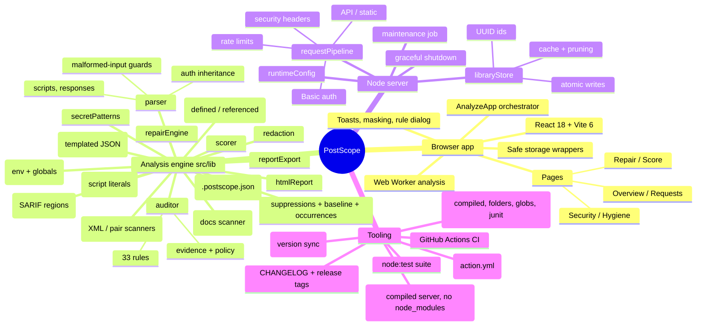
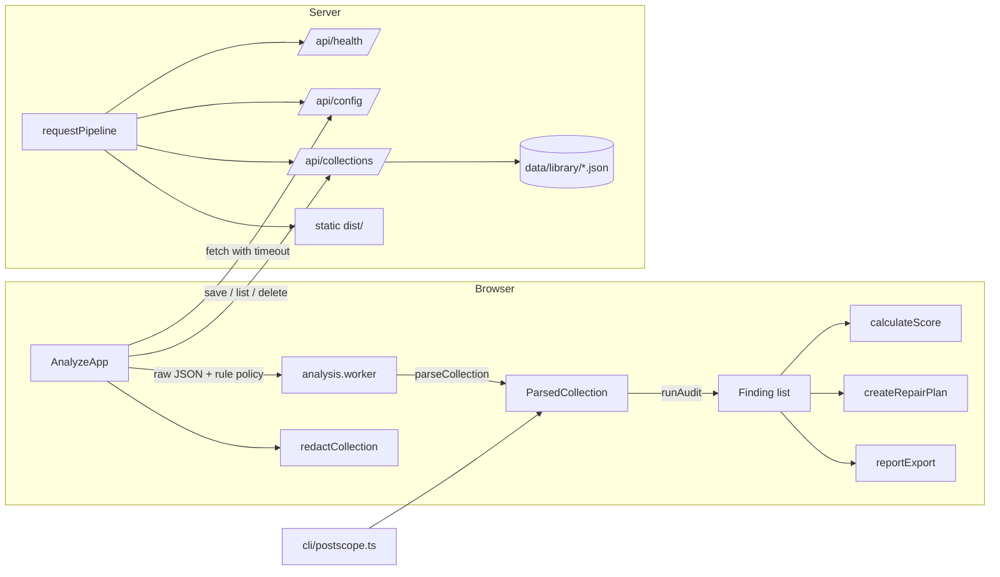

# PostScope: Technical Mindmap

> **Audience:** engineers changing PostScope's code, deployment, or security posture.
> **Companion:** [FUNCTIONAL_MINDMAP.md](FUNCTIONAL_MINDMAP.md) describes *what* the product does. [../ARCHITECTURE.md](../ARCHITECTURE.md) is the shorter architecture reference; [../SECURITY.md](../SECURITY.md) is the threat model.
> **Scope:** reflects the code after release V0.1.25. Each release updates the sections it touches and adds a line to section 10.

---

## Overview

---

## 1. Repository layout

| Path | Contents |
|---|---|
| `src/lib/` | Framework-free analysis engine shared by the browser, the server, and the CLI |
| `src/workers/analysis.worker.ts` | Web Worker entry: `analyze` (`JSON.parse` → `parseCollection` → `runAuditDetailed`) and `audit` messages; keeps the full parsed collection per slot and returns a compact copy |
| `src/lib/iam/` | Identity analysis (V0.2.1): `types.ts` (profile model), `url.ts` (host and normalized path, request parameters), `fingerprints.ts` (platform table), `endpoints.ts` (endpoint classes), `profile.ts` (`buildIdentityProfile`), `signals.ts` (auto-enable check), `report.ts` (JSON section) |
| `src/lib/compare.ts`, `compareReport.ts` | Comparison of two analyzed collections and its text, Markdown and JSON renderers (see 2.8) |
| `src/pages/`, `src/components/` | React UI (pages, layout, shadcn-style primitives in `components/ui`) |
| `server/` | Node HTTP server and Vite dev/preview middleware |
| `cli/postscope.ts`, `cli/inputs.ts` | CI scanner; `inputs.ts` expands folders and globs and finds sibling environment files |
| `action.yml` | Composite GitHub Action (builds the CLI with esbuild, scans, writes SARIF and a job summary) |
| `dist-node/` | Build output of `npm run build:node` (gitignored): `cli.js` and `server.js` |
| `tests/` | `node:test` suites run through `tsx` (`npm test`) |
| `scripts/` | Demo collection generator, test runner, `release-check.mjs`, `bench.mjs` and `bench-baseline.json` (performance budgets) |
| `public/samples/` | Bundled sample collections |
| `docs/` | Architecture, deployment, security, design system, mindmaps |
| `mindmap/ROADMAP.md` | Release plan and conventions (one commit per version) |
| `CHANGELOG.md` | Shipped changes per version, newest first |

## 2. Analysis engine (`src/lib`)

All modules are pure TypeScript with relative imports only, so the same code runs in the browser, the Web Worker, Node (server redaction and policy), and the CLI.

### 2.1 Parser (`parser.ts`)

`parseCollection(json) → ParsedCollection`

| Concern | Behavior |
|---|---|
| Validation | Throws `Invalid Postman collection format` unless the root is an object with an `item` array |
| Malformed items | Non-object items, non-array folders, and nesting deeper than 100 levels are skipped and reported in `parseWarnings` (max 25) |
| Request IDs | Unchanged historical scheme: `folder/path/name`, duplicates suffixed `#2`, `#3`, … Findings and the repair engine key on these |
| Auth inheritance | Effective auth = request auth → nearest folder auth → collection auth (`inherit` / missing = defer). Exposes `auth`, `authSource`, `authOwnerPath`, `authFields`, `basicAuth` |
| Auth owners | Collection- and folder-level auth definitions in `authOwners` so leaks are found even when no request inherits them |
| Headers | Array form or raw `Key: value` string block; non-string values coerced. Disabled headers are kept separately in `disabledHeaders` (active `headers` is unchanged for existing consumers) |
| URLs | String or object form; `path` segments may be strings or `{ value }` objects; query from `url.query` (disabled entries go to `disabledQueryParams`) or parsed from raw |
| Bodies | Mode-aware: raw, urlencoded and form-data fields (`bodyFields`, file fields skipped; disabled fields in `disabledBodyFields`), GraphQL query + variables |
| Scripts | Request `event[]` → `scripts.prerequest/test` (disabled events in `scripts.disabledPrerequest/disabledTest`); collection/folder events → `ParsedCollection.scripts` with `disabled: true` when switched off |
| Saved responses | Up to 50 per request; headers, body (first 64 KB), original request headers (`disabledRequestHeaders` for disabled ones)/URL/query (`requestQuery`)/body (`requestBody`, 64 KB)/auth |
| TLS | `protocolProfileBehavior.strictSSL` inherited collection → folder → request (`tlsVerificationDisabled`) |
| Environments | `environment.ts`: `parseEnvironment` reads `values[]` of `*.postman_environment.json` / `*.postman_globals.json` (kind from `_postman_variable_scope` or the file name). `attachEnvironments` adds `ParsedCollection.environments` and `activeEnvironment` (unreadable files become parse warnings). `lookupVariableValue` resolves a key by selected environment, then collection, then globals |
| Descriptions | Collection `info.description`, folder and request descriptions (string or `{ content }`, 64 KB each) in `ParsedCollection.descriptions` with owner, item path and request id |
| Scoped variables | Folder and request `variable[]` in `ParsedCollection.scopedVariables` (scope, owner, item path) |
| Path variables | `url.variable[]` in `ParsedRequest.pathVariables` |
| Variables | `variables.ts`: names may contain dashes/dots/spaces; `{{$dynamic}}` names excluded |

### 2.2 Rule engine (`auditor.ts`, `rules.ts`, `severity.ts`)

- **Rule packs and compliance metadata** (`rulePacks.ts`, `ruleMetadata.ts`): every `RuleDefinition` has a `pack` (`core`, `iam-am`, `iam-iga`, `iam-pam`, `iam-platform`), `tags` and optional `references` (`nist80053`, `iso27001`, `cisV8`, `rfc`). The core metadata lives in `ruleMetadata.ts` so the original rule definitions stay untouched. `AuditOptions.rulePacks` is `{ enabled?, disabled? }`; `resolveEnabledPacks(settings, identityDetected)` runs `core`, every pack forced on, and every optional pack when `detectIdentitySignals` (`iam/signals.ts`: oauth2 helpers, identity hosts and paths) is true, minus packs forced off (off wins). `FindingCollector.build` skips rules of packs that did not run and `AuditResult.packs` lists the packs that ran. Settings come from `AUDIT_RULE_PACKS`, `--packs`, `.postscope.json` `rulePacks` and the Rules dialog (Auto, Always on, Off per pack); `parseRulePacks` parses `iam-am,-iam-pam`, `auto` and `none`.
- **Identity category and score:** `FindingCategory` gains `identity` (after `auth`, before `hygiene`). It counts toward the security score, and `ScoreBreakdown.categories.identity` is present only when at least one identity finding exists, so collections without identity content never show a perfect identity score.
- `rules.ts` is the registry: id, title, description, recommendation, default severity, category, CWE, OWASP. Titles of the original rules are unchanged.
- `runAudit(parsed, options?)` feeds a `FindingCollector`: each rule records affected request IDs and **masked evidence** (`{ requestId?, location, preview }`, de-duplicated, max 100 per finding).
- `build(options)` applies `disabledRules` and `severityOverrides`, then sorts by severity (stable, registry order).
- `Finding.id === Finding.ruleId`: stable and unique per run (the old `Date.now()` suffix was removed).
- `sanitizeAuditOptions` normalizes untrusted policy input (localStorage, server env).
- `KNOWN_SECRET_PATTERN` only reports requests no keyword rule already flagged, to avoid double counting.
- **Disabled entries** (Postman keeps them in the export) go through the same secret rules as active ones; evidence locations end with ` (disabled)`. `MISSING_AUTH`, `EMPTY_HEADERS` and the other hygiene checks only look at active entries, so a disabled `Authorization` header never counts as protection.
- **Variable integrity** (`variableUsage.ts`, `checkVariableIntegrity`): `analyzeVariableUsage` collects references per request and place (URL, headers, path variables, body, auth, `pm.*.get('x')` and `pm.variables.replaceIn('{{x}}')` in request, folder and collection scripts), the definitions (enabled collection variables, folder and request variables visible to the request, the selected environment, globals, `pm.*.set('x', ...)` in any script, `pm.iterationData.get` names) and the unused collection variables. `{{$dynamic}}` names are ignored and disabled entries only count as usage. `UNDEFINED_VARIABLE` (warning) is downgraded to info for the run when no environment is loaded or a script sets variables with computed names, and its description says why; a user severity override still wins (`FindingCollector.setSeverity`). `UNUSED_COLLECTION_VARIABLE` (info, hygiene) skips empty `baseUrl`/`apiKey`/`token` starter placeholders. The Overview variables card uses the same function, so counts match the findings.
- **Occurrences, suppressions and baselines** (`occurrences.ts`, `suppressions.ts`, `baseline.ts`, `projectConfig.ts`, `sha256.ts`): an occurrence is one evidence entry or one affected request without evidence, fingerprinted as `sha256(ruleId | requestId | evidence.location)` (previews are left out so rotating a secret keeps the fingerprint; `sha256.ts` is a small synchronous implementation because the engine also runs in the worker). `splitFindingByOccurrence` splits a finding into kept and matched occurrences, adjusting `affected`, `evidence` and a leading request count in the description. `runAuditDetailed` returns `{ findings, suppressed }`; `runAudit` returns the active findings only, so scoring, `--fail-on`, repair and the pages are unchanged. Suppressions come from `AuditOptions.suppressions` (config) and from `postscope-ignore` lines in collection, folder and request descriptions; they are matched per occurrence, expire at the end of the `expires` day (UTC, clock injectable with `AuditOptions.now`), and expired or malformed ones add `SUPPRESSION_EXPIRED` / `SUPPRESSION_INVALID` (info, hygiene). The baseline (`version: 1`, sorted entries of fingerprint, rule id, request id and location, no values) is applied by the CLI after suppressions.
- **`SECRET_IN_ENVIRONMENT`** (`findLeakedEnvironmentVariables`, critical): same credential test as collection variables (credential-like name, `type: secret`, provider token) for every loaded environment and globals file, including disabled entries (labelled `(disabled)`). Evidence `environment "X" variable key` / `globals "X" variable key`; requests referencing the variable are listed as affected. `resolveLeadingVariable` now goes through `lookupVariableValue`, so `INSECURE_HTTP` follows the selected environment. There is no automatic repair (the secret is not in the collection JSON): the fix is manual and points to the sanitized environment export.
- **Basic tokens** (`checkHeaderList`): an `Authorization: Basic` value is decoded. A variable or placeholder password (for example the base64 of `svc:{{password}}`) is not a leak and raises nothing; a literal password reports `HARDCODED_TOKEN` with `basic credentials for user s••••••` (and `(Mailgun API key)` for `api:key-<32 hex>`). Values that do not decode keep the old behavior. `X-Vault-Token` is now treated like the other token headers.
- **`HIGH_ENTROPY_LITERAL`** (`checkHighEntropy`, runs last): literal values in credential positions (sensitive header names except `Cookie`, sensitive query params, form fields and JSON body fields) that qualify as `isHighEntropyLiteral` and were not already reported at the same location by a secret rule, and that are not provider tokens. Readable Basic tokens are skipped. No repair exists for it (manual review).
- **URL and auth rules** (`urlHostname`, `hasCredentialsOutsideAuthHelper`): `HARDCODED_BASEURL` fires for `http(s)://` URLs whose authority has no `{{variable}}` (a variable later in the URL does not count; any leading variable name counts). `HARDCODED_ENV_URL` tests the hostname only, split on `.` and `-` labels (`prod`, `production`, `stg`, `staging`, `stage`, `dev`, `develop`, `qa`, `uat`, `preprod`, `sandbox`, `test`, `int`) plus `localhost`; path segments such as `/v1/prod/items` are ignored, variables in the path do not suppress it, and the evidence shows the host. `MISSING_AUTH` (mutation method, effective auth `noauth`) is suppressed by an enabled sensitive header (not CSRF/XSRF), a cookie, a credential-like query parameter (literal or variable) or a request, folder or collection pre-request script that sets `Authorization` (`pm.request.headers.add|upsert`, `pm.request.auth =`); its evidence is the route (`POST /v1/users`).
- **Script literals** (`scriptSecrets.ts`): one scanner returns each credential literal with its exact range, so the auditor (`SECRET_IN_SCRIPT` evidence) and redaction (replacement) agree. Covered: `pm.*.set('sensitiveKey', 'literal')`, `const/let/var` assignments and object properties with credential-like names, `Authorization` / `Proxy-Authorization` / `Cookie` literals (value must start with an auth scheme or be a long token; scheme is kept when redacting), `{ key: 'Authorization', value: '...' }` pairs in either order (`pm.request.headers.add|upsert`, `pm.sendRequest` header arrays, `pm.request.auth` bearer entries), `pm.request.headers.add('Name: value')`, `btoa('user:literal')` and `Buffer.from('user:literal').toString('base64')`, plus provider token formats. Template strings with `${...}`, variables, `pm.environment.get(...)` concatenations and non-credential names are ignored. All regexes are linear and line-bounded.
- **Descriptions** (`descriptions.ts`): provider token formats plus `key: value` / `key=value` fragments whose key is credential-like and whose value contains a digit or symbol (so prose such as `token: required` is ignored) and `Authorization: Bearer ...` examples. Provider tokens report as `KNOWN_SECRET_PATTERN`, fragments as `HARDCODED_SECRET`, with location `description (collection)`, `description (folder "X")` or `description` (request). Text over 64 KB is scanned in chunks when sanitizing.
- **Scoped variables** reuse the collection variable test (`findLeakedScopedVariables`) and report under `SECRET_IN_COLLECTION_VARIABLE` as `folder variable key (folder "X")` / `request variable key`. Path variables with credential-like names report under `SECRET_IN_QUERY` as `path variable key`.
- **Saved example requests**: the original request query and body go through the same classifiers as live requests and report under `SECRET_IN_SAVED_RESPONSE` (`original request body password`).
- **Body scanning:** JSON bodies are parsed with `parseTemplatedJson` (`jsonBody.ts`), which swaps unquoted `{{var}}` tokens for quoted `{{token}}` strings, parses, and can `restore` the original tokens after re-serializing (linear, string-aware, tokens limited to 200 chars). Bodies that are not JSON go through `scanRawBodyFields` (`rawBody.ts`): `key=value` pairs, `<password>literal</password>` XML elements (namespaces allowed) and `"key": "value"` fragments. Every candidate is classified by `classifyBodySecret`, so evidence is precise (`raw body Password`). The old whole-body keyword heuristic was removed.
- Shared helpers exported for the repair and redaction engines: `classifyBodySecret`, `isQuerySecret`, `findLeakedCollectionVariables`, `AUTH_HEADER_SCHEME`, `TOKEN_HEADER`, `SESSION_COOKIE`, `plaintextOrigin`, `resolveLeadingVariable`.

| Category | Rules |
|---|---|
| secrets (critical) | `SECRET_IN_ENVIRONMENT`, `HARDCODED_PASSWORD`, `HARDCODED_TOKEN`, `HARDCODED_API_KEY`, `HARDCODED_SECRET`, `HARDCODED_AUTH_CREDENTIAL`, `SECRET_IN_QUERY`, `CREDENTIALS_IN_URL`, `SECRET_IN_SCRIPT`, `SECRET_IN_COLLECTION_VARIABLE`, `SECRET_IN_SAVED_RESPONSE`, `KNOWN_SECRET_PATTERN` |
| secrets (warning) | `SECRET_LOGGED_IN_SCRIPT`, `HIGH_ENTROPY_LITERAL` |
| variables | `HARDCODED_BASEURL`, `HARDCODED_ENV_URL`, `UNDEFINED_VARIABLE` (warning, informational when uncertain), `NO_COLLECTION_VARIABLES` (info) |
| auth | `MISSING_AUTH` (API key, cookie, query credential and auth script aware), `BASIC_AUTH_PLAINTEXT`, `INSECURE_HTTP`, `TLS_VERIFICATION_DISABLED` (warning), `INCONSISTENT_AUTH` (info) |
| identity (`iam-iga`, V0.2.5) | `SCIM_BULK_DESTRUCTIVE`, `SCIM_PRIVILEGE_PATCH` (warning, info when no admin literal), `SCIM_UNBOUNDED_LIST`, `SCIM_CONTENT_TYPE`, `SCIM_SCHEMA_MISMATCH` (info) |
| identity (`iam-am`, V0.2.2 to V0.2.4) | `OAUTH_TOKEN_ENDPOINT_HTTP`, `OAUTH_TOKEN_IN_URL`, `JWT_ALG_NONE`, `SAML_ASSERTION_CAPTURED` (critical), `JWT_LONG_LIVED`, `JWT_SENSITIVE_CLAIMS`, `ID_TOKEN_AS_BEARER`, `SAML_IDP_METADATA_HTTP` (warning), `JWT_EXPIRED_STORED`, `SESSION_COOKIE_FLAGS`, `TOKEN_REVOCATION_NOT_COVERED` (info), `OAUTH_IMPLICIT_GRANT`, `OAUTH_PASSWORD_GRANT`, `OAUTH_PKCE_MISSING`, `OAUTH_PKCE_PLAIN`, `OAUTH_REDIRECT_URI_UNSAFE`, `OAUTH_BROAD_SCOPE` (warning), `OAUTH_STATE_MISSING`, `OAUTH_CLIENT_SECRET_POST` (info). The other identity packs follow in later releases |
| hygiene (info) | `MISSING_DESCRIPTION`, `EMPTY_HEADERS`, `DUPLICATE_REQUEST_NAMES`, `PLACEHOLDER_REQUEST_NAMES`, `ROOT_LEVEL_REQUESTS`, `DEEP_FOLDER_NESTING`, `GET_WITH_BODY`, `UNUSED_COLLECTION_VARIABLE`, `SUPPRESSION_EXPIRED`, `SUPPRESSION_INVALID` |

### 2.3 Secret detection (`secretPatterns.ts`, `authSchemes.ts`)

| Function | Purpose |
|---|---|
| `SECRET_PATTERNS` / `findSecretPatterns` | 32 provider formats: AWS, GitHub, GitLab, Slack token + webhook, Stripe live, Google, Anthropic, OpenAI, SendGrid, Twilio, npm, Azure storage, JWT, private keys, connection strings, plus (V0.1.33) Microsoft Entra ID client secrets (`Q~`), Okta `SSWS` tokens, HashiCorp Vault `hvs.`/`hvb.`/`hvr.` tokens, Postman `PMAK-`, Atlassian `ATATT3`, Shopify `shp*_`, DigitalOcean `do*_v1_`, Docker Hub `dckr_pat_`, Grafana `glsa_`/`glc_`, Hugging Face `hf_`, Databricks `dapi`, PyPI `pypi-AgE`, Square `sq0atp-`/`sq0csp-`/`EAAA`. Linear regexes; inputs over 512 KB scanned partially. Legacy Vault `s.` tokens and Mailgun `key-` values are only recognized in header context (`X-Vault-Token`, Basic `api:key-...`) because the bare shapes are too common |
| `decodeBasicCredentials`, `maskUsername` | Reads `Authorization: Basic <base64>` into `user:password` (UTF-8, URL-safe alphabet accepted) for the header rule and for redaction |
| `shannonEntropy`, `isHighEntropyLiteral` | Bits per character; a literal qualifies at 20+ characters and 3.5+ bits, without whitespace, not a UUID, URL or placeholder, and not pure hex under 32 characters (an auth scheme prefix is ignored) |
| `isSensitiveKey` | Credential-like names (`password`, `client_secret`, `apiKey`, `sessionId`, …) minus false positives (`bypass`, `tokenUrl`, `token_type`, `pageToken`, `passwordPolicy`) |
| `isSensitiveHeader` | Known credential headers plus `isSensitiveKey` |
| `isLikelySecretValue` | Non-empty, not a variable, not a placeholder (`<string>`, `changeme`, `your-…`, `demo-…`) |
| `maskSecret`, `evidencePreview`, `redactSecretsInText` | Display masking (keeps auth scheme, first 4 chars only for long values, length hint) |
| `AUTH_SECRET_FIELDS`, `getAuthEntries` | Secret fields per Postman auth type; reads v2.1 arrays and v2.0 objects |

### 2.4 Scoring (`scorer.ts`, `requestFindings.ts`)

**Scoring model v2** (`scoreModel: 2` in reports; `SCORE_MODEL` in `scorer.ts`):

| Piece | Rule |
|---|---|
| Weights | `critical=20, warning=8, info=2` by default; override with `SCORE_WEIGHTS` (server, sent through `/api/config` and applied with `setActiveScoreWeights`) or CLI `--weights`; each value 0 to 100, invalid entries ignored |
| Penalty per finding | `weight * (1 + log2(affectedCount))`, capped per rule at `weight * 1.75` (critical, 35 by default), `weight * 1.875` (warning, 15) and `weight * 2` (info, 4). `affectedCount` is the number of affected requests; collection-level findings use their evidence count, at least 1 and at most 8 |
| Security score | `100 - sum(penalties)` over the secrets, variables and auth categories, clamped to 0 to 100 |
| Hygiene score | Same formula over the hygiene category only, so hygiene notes can no longer lower the security score |
| Headline `total` | `round(0.85 * security + 0.15 * hygiene)`; grade A at 90, B 75, C 55, D 35, else F |
| Categories | Each category score is `100 - sum(penalties of that category)` |
| `penalties[]` | Every finding with rule id, severity, category, affected count and points, largest first; shown on the Score page and included in the JSON report |
| Per-request health | `requestHealthScore` keeps the flat table (one request is one affected request, each finding costs its weight once) |
| `--min-score` | Compares against the headline `total`; scores differ from model 1, so CI thresholds set before V0.1.36 may need adjusting |

Properties covered by tests: more affected requests never raise the score, scores stay within 0 to 100, weights override the defaults, and hygiene never affects `security`.

### 2.5 Repair engine (`repairEngine.ts`)

- `createRepairPlan` maps each finding to a fix by **rule id** (`KIND_BY_RULE`), falling back to title matching for findings without a rule id.
- `applyRepairPlan` deep-clones the raw collection, runs the selected patchers, ensures referenced collection variables exist, and returns `applied` / `skipped` with reasons.

| Kind | Patch |
|---|---|
| `hardcodedBaseUrl`, `environmentUrl` | Each literal origin → its own collection variable. `buildOriginVariableMap` ranks origins by request count: the most frequent keeps `baseUrl`, the others are named from the first host label (`auth.example.com` → `authBaseUrl`, collisions get `2`, `3`, ...). An existing `baseUrl` variable keeps its meaning (reused only for the origin it points at). The map is stored on the fix (`originVariables`) and listed in its description. URLs are split as written (never through `new URL`), so `{{vars}}` in paths and the `#hash` survive; object URLs get `host` replaced and `protocol`/`port` removed, `path`, `query` and `variable` kept |
| `hardcodedAuthToken` | Authorization (any scheme), token headers, session cookies → variables (disabled headers included) |
| `hardcodedApiKey` | API key headers → `{{apiKey}}` |
| `basicAuthCredentials` | Finds the **effective** auth owner (request/folder/collection) and patches it once |
| `authHelperSecrets` | Walks collection, folder, and request auth; secret fields → `{{token}}`, `{{clientSecret}}`, … |
| `bodySecrets` | Password headers, JSON bodies (indentation preserved, unquoted `{{vars}}` kept), XML/form-like raw bodies (value replaced in place), urlencoded/form fields → `{{fieldName}}` (disabled entries included, they stay disabled) |
| `querySecrets` | Raw URL and `query[]` kept in sync |
| `secretVariables` | Clears leaked collection variable values and leaked folder/request variable values (targeted by item path) |
| `insecureHttp` (high risk) | `http`→`https`, `ws`→`wss`, including the collection variable behind a leading `{{baseUrl}}` |
| `tlsVerification` | Removes `strictSSL: false` along the item chain |
| `emptyHeaders`, `collectionVariables`, `missingDescription` | As before |
| `undefinedVariables` (low risk, not selected) | Adds an empty collection variable for every referenced but undefined name |

### 2.6 Redaction (`redaction.ts`)

`redactCollection(json) → { json, redactedCount }` returns a sanitized deep copy. Request-side credentials become `{{variables}}` (runnable after setting values); scripts, saved responses, and free text get `{{REDACTED}}`; collection variable values are emptied. `redactedCount` counts each removed secret once (query array entries and their raw URL copy are not double counted; a string URL counts every credential pair). `redactEnvironment` empties credential values in an environment or globals export (names, keys, types and `enabled` flags are kept). Script literals are replaced in place with `{{REDACTED}}` (the exec lines are scanned as one source so multi-line objects are covered; line count is preserved). Raw bodies are edited structurally when they are JSON (indentation and unquoted variables preserved) and field by field otherwise (XML elements, `key=value` pairs). Descriptions (collection, folder, request, URL path variable docs) get `{{REDACTED}}` in place of credentials, folder and request `variable[]` values are emptied like collection variables, and path variable values with credential-like names become `{{name}}`. It is idempotent. Disabled headers, query params, form fields and events are scrubbed like active ones. Used by the "Sanitized copy" export, the CLI `--sanitize`, and server-side `LIBRARY_REDACT_SECRETS`.

### 2.7 Reports (`reportExport.ts`)

Reports receive `suppressed` and `baselined` in `ReportContext`: JSON adds `occurrences` (fingerprints) per finding, a `suppressed` list and `baseline.hiddenOccurrences`; SARIF results carry `postscope/v1` (kept for existing alerts) and `postscope/v2` (occurrence) fingerprints and suppressed results get `suppressions` (`inSource` for inline, `external` for config); Markdown has a Suppressed section.

`buildJsonReport`, `buildSarifReport`, `buildMarkdownReport` and `buildHtmlReport` (`htmlReport.ts`). Only masked evidence is included. `safeFileStem` produces filesystem-safe names.

| Piece | Behavior |
|---|---|
| JSON | `reportVersion: 2` (`REPORT_VERSION`), `score` with `scoreModel` and `penalties`, `occurrences` per finding, `suppressed`, `baseline`. The contract is `docs/schemas/postscope-report.v2.schema.json` (draft-07); `tests/reportsV2.test.ts` validates generated reports with the small validator in `tests/schema.ts` and checks that drift is rejected. Add fields only with a version bump or as optional properties |
| Evidence pointers | `ParsedRequest.pointer` is the JSON pointer of the raw item (`/item/0/item/3`). `attachEvidencePointers(rawJson, parsed, findings)` maps each evidence location (`header X`, `query k`, `body field k`, `... script`, `saved response "X"`, descriptions, auth owners, collection variables, ...) to a pointer such as `/item/0/item/3/request/header/1/value`, falling back to the request. It runs at report time on the raw file (CLI and export), not during the audit, and pointers never enter fingerprints |
| `jsonPositions.ts` | `locatePointers(text, wanted)` maps pointers to `{ line, column }` in one pass over the original text. Memory is proportional to nesting depth (subtrees that cannot contain a wanted pointer are skipped), CRLF, LF and CR are handled, columns count UTF-16 code units, and malformed input never throws |
| SARIF 2.1.0 | Rule catalog with `security-severity`; one result per finding and affected request; `region.startLine/startColumn` when `sourceText` and a pointer are available; `columnKind: utf16CodeUnits`; `invocations[0].executionSuccessful`; `automationDetails.id` (`postscope/<collection>/<date>`); a `toolExecutionNotifications` warning when more than 5000 results were dropped; `partialFingerprints` `postscope/v1` and `postscope/v2`; `suppressions` on suppressed results |
| HTML | One document (`renderHtmlReports` accepts several collections): inline CSS with light/dark and print styles, no scripts, no external requests, no event handlers. Every dynamic string goes through `escapeHtml`. Sections: summary cards, findings by severity with score impact, suppressed, environments, parse warnings |

### 2.7.1 Identity profile (`src/lib/iam/`)

`buildIdentityProfile(parsed)` returns `{ platforms, endpoints, oauthClients, scopes, grants, tokens }`. It is static: no network, no signature checks, and nothing in it is a secret (client ids keep four characters, token previews use `maskSecret`). `runAuditDetailed` builds it when `detectIdentitySignals` is true or an identity pack is forced on, and stores it on `parsed.identity` only when it is not empty, so every audit (for example after another environment is selected) starts from fresh hosts. The scorer adds `categories.identity` when the profile or an identity finding exists.

| Piece | Behavior |
|---|---|
| `url.ts` | `splitUrl` resolves a leading `{{variable}}` through the selected environment, collection variables and globals (three levels), returns host, port and a normalized path with variables and `:params` replaced by `*`; an unknown host stays unknown (`hostVariable`). `requestParams` merges query, form and top-level JSON fields by lowercase name (the query wins) |
| `fingerprints.ts` | `PLATFORM_FINGERPRINTS`: 17 platforms (Okta, Entra ID, Auth0, Ping, ForgeRock, Keycloak, SailPoint, Saviynt, One Identity, Omada, CyberArk, BeyondTrust, Delinea, Vault, AWS, Azure and Google Cloud IAM) with host, strong path, path, header, token shape, port, variable name and auth helper signals. Per request the weights are host 0.6, strong path 0.5, header 0.5, token 0.5, path 0.3, auth helper 0.3, port 0.2, variable name 0.15; at least 0.5 is needed. Platform confidence is the best request score plus 0.04 per extra request (max +0.2). Several platforms per collection are normal |
| `endpoints.ts` | `classifyEndpoint(context)` returns one class (`oauth.token`, `oauth.authorize`, `oauth.par`, `oauth.device`, `oauth.introspect`, `oauth.revoke`, `oidc.*`, `saml.*`, `scim.*`, `iga.*`, `admin.*`, `pam.*`, `vault.*`, `cloud-iam.*` or `unknown`) from the method, normalized path, host and parameter names; the first matching rule wins and values are never read. AWS actions come from `Action=` or `X-Amz-Target` |
| `profile.ts` | OAuth clients from oauth2 auth helpers (`grant_type`, `challengeAlgorithm`, `client_authentication`, `scope`, `redirect_uri`, token and auth URLs; inherited helpers are one client per owner) and from authorize, token, PAR and device requests (`response_type`, `grant_type`, `client_id`, `client_secret`, `client_assertion`, `code_challenge(_method)`, `code_verifier`, `redirect_uri`, `scope`). Authorize and token requests with the same client id merge. `pkce` is `S256`, `plain` (a challenge without a method is plain, RFC 7636), `present`, `absent` or `not-applicable`. Literal tokens in `Authorization`, `X-Vault-Token`, auth helpers and collection variables are inventoried by kind (`jwt`, `okta-ssws`, `vault-token`, `ps-auth`, `entra-client-secret`, `bearer-opaque`) with masked previews |
| JSON report | `identityReportSection` adds an `identity` object (platforms, endpoint counts and list, OAuth clients, scopes, grants, token previews) described by the schema; it is absent when the profile is empty |

### 2.7.2 Identity rules (`iam/rules.ts`, `iam/ruleIds.ts`, `iam/checks.ts`, `iam/oauth.ts`)

Identity rule definitions live in `iam/rules.ts` and their ids in `iam/ruleIds.ts` (`IAM_RULE_IDS`), which `rules.ts` folds into `RuleId`, so the registry and the `RuleId` type stay in step (a test checks both lists). `runIdentityChecks(parsed, profile, out, packs)` runs after the core checks and only when the audit built a profile; each pack's checks only read the profile and the requests, through the small `FindingSink` interface that `FindingCollector` implements. Every identity rule uses category `identity`, has a pack, tags, CWE and OWASP where one applies, and NIST SP 800-53, ISO/IEC 27001 and RFC references.

| Rule | How it decides |
|---|---|
| `OAUTH_IMPLICIT_GRANT`, `OAUTH_PASSWORD_GRANT` | OAuth client grant from `response_type` (`token`, or `id_token` without `code`) or `grant_type`, and from the oauth2 helper (`implicit`, `password_credentials`) |
| `OAUTH_PKCE_MISSING` | Authorization code client with PKCE `absent` and client authentication `none` (no secret). A merged authorize and token pair with `code_verifier` counts as protected; confidential clients are skipped |
| `OAUTH_PKCE_PLAIN` | `code_challenge_method=plain`, a challenge without a method (RFC 7636 default), or helper `challengeAlgorithm: plain` |
| `OAUTH_REDIRECT_URI_UNSAFE` | `unsafeRedirectReason`: wildcard, user info, `http:` to a non-local host (`isLocalHost` now lives in `localHost.ts`), or a URL in `url`, `redirect`, `next`, `return`, `continue`, `dest`, `target`, `goto` parameters. Evidence drops the query string |
| `OAUTH_STATE_MISSING` | Authorize or PAR request with `response_type` but no `state`, no `code_challenge` and no OpenID `nonce` |
| `OAUTH_TOKEN_ENDPOINT_HTTP` | `oauth.token`, `oauth.introspect`, `oauth.revoke` endpoints whose resolved scheme is `http` and host is not local. It adds to `INSECURE_HTTP` for the same request |
| `OAUTH_TOKEN_IN_URL` | `access_token`, `id_token` or `code` with a literal value in the query or fragment of a request URL or a saved example's original request; skipped when `SECRET_IN_QUERY` already reported the same location |
| `OAUTH_BROAD_SCOPE` | `broadScopeReason`: generic wildcard and `admin`, `:admin`, `.manage` endings, Entra, Okta, Auth0 and Google catalogs, `*.ReadWrite.All`, and `.default` on clients without a secret |
| `OAUTH_CLIENT_SECRET_POST` | Client authentication `client_secret_post` (a `client_secret` body field, or helper `client_authentication: body`) |

Request-level clients report their requests as affected. A helper defined on the collection or a folder is collection-level evidence (`oauth2 helper grant (collection)`) so one inherited helper does not mark every request. Clients are merged by platform, client id and grant, so the same client id used with two flows stays two clients. `detectIdentitySignals` also looks at OAuth parameters in URLs and form bodies, and the audit attaches the profile whenever identity is detected, even when it is empty.

### 2.7.3 JWT inspection (`iam/jwt.ts`, `iam/jwtChecks.ts`, `components/TokenInspector.tsx`)

`inspectJwt(token, now)` base64url-decodes the header and payload (`atob` plus `TextDecoder`, so it runs in the browser, the worker and Node), refuses tokens over 16 KB, never verifies a signature and returns only derived data: algorithm, type, masked key id, issuer host, expiry, lifetime, whether the token looks like an ID token (`nonce`, `at_hash`, `c_hash` or `typ` ID) or a refresh token (`typ` Refresh or Offline), the personal and privilege claim names, and every claim with a masked preview (`maskClaim`: emails `j•••@•••`, phone numbers keep two digits, arrays `[N values]`, identifiers four characters, scopes listed because they are metadata). `collectJwts(parsed)` finds JWT-shaped values (at most five per value, 200 per collection) in request headers (including disabled ones), request-level auth helpers, query, form and raw bodies, saved examples (body, headers, original request headers and auth), folder and collection auth helpers (scanned once, not per request) and variables.

| Rule | Decision |
|---|---|
| `JWT_ALG_NONE` (critical) | Header `alg` is `none` in any case |
| `JWT_LONG_LIVED` (warning) | No `exp`, or `exp - iat` over 24 hours; ID tokens and refresh tokens are skipped because their lifetime is a different matter |
| `JWT_SENSITIVE_CLAIMS` (warning) | Any personal claim (`email`, `name`, `phone_number`, `address`, `upn`, ...) or privilege claim (`roles`, `groups`, `wids`, `entitlements`, `permissions`, `realm_access`, ...). `scp` and `scope` are shown in the inspector but do not raise the rule |
| `ID_TOKEN_AS_BEARER` (warning) | An ID-token-shaped JWT in an `Authorization: Bearer` header or bearer auth helper of a request that is not an `oidc.userinfo` endpoint |
| `JWT_EXPIRED_STORED` (info) | `exp` is before `AuditOptions.now` (default now) |

`runIdentityChecks` now takes a context with the clock. A JWT in a header or auth helper is also an identity signal, so the packs switch on for collections that only store a token. The request details dialog adds Details and Token tabs only when the request holds a JWT.

### 2.7.4 SAML, sessions and revocation (`iam/saml.ts`, `iam/revocation.ts`)

| Rule | Decision |
|---|---|
| `SAML_ASSERTION_CAPTURED` (critical) | `findSamlAssertions(request)` reads `SAMLResponse` from body fields, query parameters, the raw body (`SAMLResponse=...`, JSON or HTML `<input name="SAMLResponse" value="...">`) and saved examples (response body, original request body and URL). The value is URL-decoded, base64-decoded (first 256 KB at most) and must contain an `Assertion` element; a response that carries only an error status is not reported. Evidence is `SAML assertion (N characters), issuer host`, nothing from the assertion itself. HTTP-Redirect (deflate) bindings are not inflated |
| `SAML_IDP_METADATA_HTTP` (warning) | `saml.sso` or `saml.acs` endpoints (now including `/adfs/ls`, `/FederationMetadata/` and `/<tenant>/saml2`) whose resolved scheme is `http` and host is not local |
| `SESSION_COOKIE_FLAGS` (info) | `Set-Cookie` headers and Postman `cookie` entries of saved examples whose name looks like a session or token cookie (`session`, `sess`, `sid`, `token`, `auth`, `jwt`) and that lack `Secure`, `HttpOnly` or `SameSite`. The parser keeps only the cookie name and flags (`ParsedSavedResponse.cookies`), never the value |
| `TOKEN_REVOCATION_NOT_COVERED` (info) | `checkRevocationCoverage(profile)`: platforms with an `oauth.token` endpoint and no `oauth.revoke`, `oidc.logout` or `session.terminate` endpoint. An endpoint with no detected platform covers every platform. Collection-level evidence per platform (`token requests for Okta Workforce Identity`); nothing is reported when no token endpoint exists |

New endpoint class `session.terminate`: `DELETE` on `/sessions` or `/users/{id}/sessions`, `revokeSignInSessions`, `revokeSessions` and `/users/{id}/logout` (also used by the leaver checks in V0.2.6). A `SAMLResponse` parameter is an identity signal.

### 2.7.5 SCIM provisioning (`iam/scim.ts`)

`checkScim` runs for the `iam-iga` pack over the `scim.*` endpoints of the profile. Bodies are read with `parseTemplatedJson`, so unquoted `{{variables}}` still parse, and nothing from a body is copied into evidence except operation names, attribute names and counts. `addToScimInventory` fills `IdentityProfile.scim` (one `ScimTarget` per host or host variable: resources, request count per method, request ids) while the profile is built; the JSON report has the same list under `identity.scim`.

| Rule | Decision |
|---|---|
| `SCIM_BULK_DESTRUCTIVE` (warning) | A `/Bulk` body with any `DELETE` operation, or 20 or more operations and no `failOnErrors` |
| `SCIM_UNBOUNDED_LIST` (info) | `GET` on a path ending in `/Users` or `/Groups` with no `filter`, `count` or `startIndex` parameter |
| `SCIM_PRIVILEGE_PATCH` (warning or info) | `PATCH` operations whose `path` (filters and URN prefixes stripped) or value keys are `roles`, `entitlements`, `groups`, `members` or `active`. The rule is a warning for the run when a non-`remove` operation carries a literal value that names an administrative role or group (`admin`, `administrator`, `owner`, `root`, `superuser`, `privileged`, plural forms included), otherwise info (`FindingCollector.setSeverity`; a user override still wins) |
| `SCIM_CONTENT_TYPE` (info) | `POST`, `PUT` and `PATCH` with a body and a Content-Type that is missing or not `application/scim+json` |
| `SCIM_SCHEMA_MISMATCH` (info) | JSON body whose `schemas` lacks the User, Group, PatchOp or BulkRequest URN (case-insensitive). Paths under `/scim/v1` are skipped because SCIM 1.1 uses other URNs |

`detectIdentitySignals` and the profile now resolve a leading `{{variable}}` first, so `{{scimBase}}/Users` with `scimBase` set to a `/scim/v2` URL counts as SCIM.

### 2.8 Comparison (`compare.ts`, `compareReport.ts`)

`compareCollections(before, after)` takes `{ parsed, findings, score? }` for each side and returns a `Comparison` (no secret values, deterministic order).

| Piece | Behavior |
|---|---|
| Request matching | Pass 1 pairs requests with the same id (`folder/name`, `#n` for duplicates). Pass 2 pairs the rest by `METHOD + normalizeRequestUrl(url)` (query, fragment and trailing slash removed, scheme and host lower-cased, variables kept as written); several candidates with one key are paired in order of appearance. Unpaired requests are `added` or `removed`; paired ones with differing name, folder, method, url, auth, body, headers or scripts are `changed` with the list of fields, otherwise `unchanged` |
| Finding matching | Every finding becomes occurrences (`findingOccurrences`, V0.1.37). The key of an occurrence is its fingerprint computed with the OLDER request id (`idMap` translates ids of matched requests), so a renamed request keeps its keys and its findings are `unchanged`, not new plus resolved. `added` = keys only in the new side, `resolved` = keys only in the old side. Sorted by severity, rule, request, location |
| Score | `scoreDelta` is `after - before` for total, security and hygiene (positive is better), using each side's own findings and the active weights |
| Hosts and auth | `newHosts`/`removedHosts` (via `urlHostname(resolveLeadingVariable(url))`) and `newAuthTypes`/`removedAuthTypes` (`parsed.authTypes`) |
| Privacy | Requests are described by id, name, method, folder and the URL without query string. Evidence previews and bodies are never copied |
| `newFindingsAtOrAbove(comparison, level)` | The CLI failure condition for `--fail-on-new` |
| Reports | `buildComparisonText`, `buildComparisonMarkdown` (escaped, capped at 50 rows per list) and `buildComparisonJson` (`reportVersion: 1`, `kind: "comparison"`) |

CLI: `postscope diff <old> <new>` (`runDiff` in `cli/postscope.ts`) reuses `analyzeFile`, so project config, severity overrides, library records and evidence handling behave as for `scan`. Exit codes 0, 1 (new findings at or above `--fail-on-new`, default critical) and 2.

## 3. Browser application

### 3.1 Bootstrap and routing

`main.tsx` → `ThemeProvider` → `TooltipProvider` → `ToastProvider` → `App`. `App` fetches `/api/config` (8 s timeout; on failure it falls back to privacy-first defaults) and routes according to `publicLandingPage`: with the landing page, `/` is the landing page, `/analyze/*` the analyzer and `/samples` the samples; without it, `/samples` and everything else (`/*`) is the analyzer and `/analyze/*` redirects to `/`. `AnalyzeApp` gets `basePath` (`/analyze` or empty).

**Addresses (`appRoutes.ts`).** `parseAppLocation(pathname, search, basePath)` returns `{ page, requestId?, severity?, category?, rule?, finding?, view? }` or null; `buildAppPath(basePath, location)` is its inverse. Pages: overview (the base path), `requests`, `security`, `hygiene`, `repair`, `score`, `compare`. `/requests/<encodeURIComponent(id)>` selects a request (ids contain `/`, spaces and dots). Filters are only read on `security` (severity, category, rule, finding, `view=suppressed`) and `hygiene` (severity, rule, finding); unknown or malformed values are ignored, rule ids must match `^[A-Z][A-Z0-9_]{1,63}$`. The active page is derived from `useLocation()` (the former `active` state is gone); `goTo(location, replace?)` navigates through a ref to `navigate` so its identity is stable. Page changes, request selection and opening a finding push history entries; filter changes and closing a finding replace. A session restore keeps the page in the address, a new import goes to the dashboard, an invalid address redirects to the dashboard. `SamplesApp` keeps the same page props with local state.

**Server fallback.** `serveStatic` serves `index.html` for browser navigations (`Accept: text/html`) to any path that is not a file, including paths whose last segment looks like a file name (`/analyze/requests/v1.2%2FGet%20item`); other requests for unknown files (scripts, data, API) still return 404.

### 3.2 `AnalyzeApp` state

| State | Notes |
|---|---|
| `parsed`, `findings`, `rawJson`, `originalRawJson` | Current analysis; original kept for repair reset |
| `analysisSeq` (ref) | Incremented per analysis; stale worker results are discarded (fast consecutive imports, "New collection") |
| `userAuditPrefs` / `auditOptions` | Browser rule policy over the server `auditPolicy`; changes re-run `runAudit` without re-parsing |
| `restoreAttempted` (ref) | Session restore runs exactly once on mount |
| `score`, `repairAutoFixCount` | `useMemo` (previously recomputed, including a full `JSON.parse`, on every render) |
| `referenceRaw`, `reference`, `referenceLoading` | Older version for the Compare page (file, library entry or the first of two dropped files). Analyzed in the worker with the current `auditOptions` and re-analyzed when they change; never saved to the library or the session |
| Library, search, nav, consent, storage mode | As before |

Imports: size guard (50 MB), `File.text()`, `analyzeCollectionText` (worker with main-thread fallback, 120 s timeout that recycles the worker), errors mapped by `describeAnalysisError` into toasts.

### 3.2.1 Environments in the browser

`DropZone` accepts several files; `AnalyzeApp.handleFiles` reads them, classifies each with `detectEnvironmentKind` / `isCollectionJson` and imports exactly one collection with the raw environment texts (`environmentTexts`). The worker receives `environments: string[]` and calls `attachEnvironments`. `handleSelectEnvironment` swaps `activeEnvironment` with `withActiveEnvironment` and re-runs only the audit. The header shows the environment name or a selector (`AppHeader` `environments` prop); Export gains "Sanitized environments" when files are loaded. `CollectionSession` stores the raw environment texts and the selected index (included in the 4.5 MB limit). Library saves and library opens deal with collections only.

### 3.3 Components added in the hardening pass

| Component | Role |
|---|---|
| `ui/toaster.tsx` | Notification stack (`role=status/alert`, auto-dismiss) replacing `alert()` |
| `SecretValue`, `MaskedText` | Masked header/query/body values with reveal toggle |
| `FindingEvidence` | Evidence list + rule/CWE/OWASP badges in Security and Hygiene dialogs |
| `RuleSettingsDialog` | Enable/disable rules, severity overrides, reset to team defaults |
| `app-header` | Export menu (Markdown, JSON, SARIF, sanitized copy) and Rules button |

### 3.3.1 Keyboard and accessibility

| Piece | Behavior |
|---|---|
| `keyboard.ts` | `isSearchShortcut(event, dialogOpen)`: Ctrl/Cmd+K anywhere, `/` outside inputs, textareas, selects, contenteditable and when a dialog is open |
| Request tree | `handleTreeKeyDown` (`RequestsPage.tsx`) on the `role="group"` container; items carry `data-tree-item="folder|request"`, folders `aria-expanded` and `data-tree-folder`; closed folder content is `inert` |
| Search dialog | Combobox pattern: the input has `role="combobox"` with `aria-activedescendant`, rows are `role="option"` (no nested buttons), the list scrolls in a focusable region |
| Shell | Skip link to `#main-content`, `nav` labeled "Pages" with `aria-current="page"`, import page wrapped in `main` with a polite live region for progress |
| Tokens | `--success-text`, `--warning-text`, `--destructive-text` (text on tints) and a base `:focus-visible` outline in `index.css`; method and protocol badges use the 700 shades; `CardTitle` is an `h2` (`as` prop); `ScrollArea` takes `focusable`; charts are `aria-hidden` with a `sr-only` summary |
| Verification | Manual axe-core 4.10 pass (light and dark) on the import page, Dashboard, Requests (with a selection), Security, Hygiene, Repair, Score and Compare, and on the search, finding and rules dialogs: zero serious or critical violations. V0.1.44 automates it |

### 3.3.2 Performance

| Piece | Behavior |
|---|---|
| Code splitting | `App.tsx` lazy-loads `AnalyzeApp` and `SamplesApp`; `AnalyzeApp` lazy-loads every page with `lazyPage` inside one `Suspense` (`PageFallback`). `vite.config.ts` has a single manual chunk (`react`); Recharts and framer-motion land in the chunks that import them, so the landing page downloads neither the parser, the audit engine nor the dashboard. Measured gzip: landing about 123 KB, analyzer about 257 KB, first dashboard view about 377 KB (before: one 697 KB entry plus preloaded charts and motion chunks) |
| Worker protocol | `analyze` (raw text, options, environments, optional `activeEnvironment`, `slot`) parses, audits, caches the full parsed collection per slot (`main`, `reference` for the Compare page) and replies with a compact copy; `audit` (options, optional `activeEnvironment`, `slot`) re-audits the cached collection. A restarted worker answers `cacheMiss` and `auditAgain` resolves to null, so `AnalyzeApp.reaudit` analyzes the text again. Without Worker support the same contract runs on the main thread (`fallbackFull`). The page no longer runs the audit itself: rule changes, environment selection, imports and repairs all go through the worker |
| Compact result (`compactResult.ts`) | Request bodies over 64 KB (`MAX_DISPLAY_BODY`) are cut to 64 KB in the copy sent to the page and flagged (`bodyTruncated`, `bodySize`); folders are rebuilt to reference the compact requests so large strings are not cloned twice. Findings always come from the full text. Main-thread statistics that read bodies (the Dashboard variable counts, the repair plan's undefined-variable suggestions) see the 64 KB prefix; comparison treats a size change as a body change |
| `VirtualList` and the request tree | `virtualWindow.ts` (`computeWindow`, `scrollTopForRow`, threshold 300) and `VirtualList.tsx` (absolute rows in a full-height spacer, `ResizeObserver`, rAF-throttled scroll, `scrollToIndex`). `requestTree.ts` builds, filters and flattens the tree (`TreeRow` with `level`, `posInSet`, `setSize`, `parentIndex`, stable keys `f:<path>` and `r:<id>`); `RequestTreeView` renders an ARIA `tree` with a roving tabindex and index-based arrow-key handling; `RequestsPage` owns the set of open folders, opens the ancestors of a request chosen from the address and scrolls it into view. 6400 rows render about 30 DOM rows |
| Other lists | Finding and repair lists are bounded by the rule catalog, search results are capped at 50, comparison tables at 200 and the Dashboard structure tree at 100 branches per level, so they are not virtualized |

### 3.4 Browser storage

`safeStorage.ts` wraps `localStorage`/`sessionStorage` so private modes and quota errors never crash the app. Keys: `postscope-theme`, `postscope:storage-mode`, `postscope:upload-risk-accepted`, `postscope:audit-rules`, and session key `postscope:collection-session`.

## 4. Node server (`server/`)

### 4.1 Request pipeline (`requestPipeline.ts`)

Shared by `index.ts` (production, serves `dist/`) and `vite-plugin.ts` (dev/preview, hands non-API requests to Vite):

1. Parse target safely (`parseRequestUrl`; `//host` targets cannot change the authority)
2. API responses get `X-Request-Id`; security headers (CSP only in production)
3. `GET /api/health` (no auth)
4. Optional Basic auth (`checkBasicAuth`, constant-time compare, 15-minute lockout per IP)
5. API: read rate limit → `/api/config` → `/api/collections` → JSON 404
6. Static: `serveStatic` (production) or `next()` (dev)
7. Optional access log (`ACCESS_LOG=true`; method, path, status, duration, IP; never bodies)

### 4.2 Endpoints

| Method + path | Behavior |
|---|---|
| `GET /api/health` | `{ status, version, uptimeSeconds, storage }`; 503 when storage is unwritable |
| `GET /api/config` | Deployment config: logging mode, landing page, links, `maxCollectionBytes`, `libraryAllowDelete`, `libraryRedactSecrets`, `auditPolicy` |
| `GET /api/collections` | Metadata list (empty in `off` mode) |
| `GET /api/collections/:id` | Full record; 400 for non-UUID ids, 404 when missing |
| `POST /api/collections` | JSON only, same-origin, write rate limit, size-capped, validated, de-duplicated (200) or created (201) |
| `DELETE /api/collections/:id` | Same-origin, write rate limit, 403 when `LIBRARY_ALLOW_DELETE=false` |

### 4.3 Modules

| Module | Responsibility |
|---|---|
| `runtimeConfig.ts` | Validated, lazily-read settings (invalid values warn once and fall back) |
| `security.ts` | Headers/CSP, client IP (`TRUST_PROXY` + `TRUST_PROXY_HOPS`, validated with `net.isIP`, socket fallback), `RateLimiter`, `AuthFailureTracker` (bounded, never evicts locked addresses, global back-off), Basic auth, same-origin check |
| `http.ts` | `HttpError`, `sendJson`, bounded `readJsonBody` (415/413/400), safe URL parsing |
| `staticFiles.ts` | Traversal-safe path resolution, MIME map, ETag/304, immutable caching for `assets/`, in-memory gzip cache |
| `libraryStore.ts` | Storage engine (below) |
| `libraryCrypto.ts` | AES-256-GCM envelope (`v`, `alg`, `kid`, `iv`, `tag`, `data`), key parsing (64 hex or base64), key ids, previous keys, keyed hash. The record id is the AAD |
| `libraryMaintenance.ts`, `libraryCli.ts` | `status` and `encrypt` (migration and rotation) for `DATA_DIR/library`, compiled to `dist-node/library.js` (`npm run library:status`, `npm run library:encrypt`) |
| `auditLog.ts` | Append-only JSONL audit trail in `DATA_DIR/audit` (queued appends, monthly files, mode `0600`) |
| `apiHandlers.ts` | Config, health, library handlers; generic 500s with request id |
| `logger.ts` | Leveled text/JSON logs to stdout/stderr |
| `loadEnv.ts`, `loggingConfig.ts`, `landingConfig.ts`, `externalLinksConfig.ts`, `appVersion.ts` | Environment loading and existing settings |

### 4.4 Library store

- Files: `DATA_DIR/library/<uuid>.json`, mode `0600`, directory `0700`.
- Writes are **atomic** (temp file + rename) and **serialized** through a promise queue (saves, deletes, pruning).
- **Metadata cache**: listing reconciles cached metadata with `readdir` names; record contents are parsed once per new file (records are immutable). Corrupt files are remembered and skipped.
- **De-duplication** by SHA-256 of the stored content; request count computed server-side (client value ignored).
- **Limits**: `MAX_COLLECTION_MB`, `LIBRARY_MAX_TOTAL_MB` (507 when full), `LIBRARY_MAX_ITEMS` and `LIBRARY_RETENTION_DAYS` (pruning after each save and in the background).
- Optional `transform` hook used for server-side redaction.
- **Encryption at rest**: with `LIBRARY_ENCRYPTION_KEY[_FILE]` the whole record (name, metadata, rawJson) is sealed into one envelope per file; reads accept both envelopes and legacy plaintext records. The deduplication hash is `HMAC-SHA256(key, content)` while encryption is on. An unusable key makes saves fail with 500 (never plaintext); an encrypted record without a matching key, or one that fails authentication, is logged and skipped like a corrupt file. `libraryEncryptionStatus()` feeds the startup banner and `libraryEncrypted` in `/api/config`.
- **Identity and audit**: `getProxyUser(req)` (`security.ts`) returns the sanitized `TRUSTED_USER_HEADER` value only when `TRUST_PROXY=true`; saves store it as `savedBy` and `apiHandlers.ts` records `save`, `open` and `delete` through `recordAudit` with the client IP (trusted hops) and request id.

## 5. Background processes

| Process | Where | What it does |
|---|---|---|
| Analysis worker | Browser | Parses and audits off the main thread; timeout recycles the worker; falls back to main thread if workers are unavailable |
| Stale-result guard | Browser | `analysisSeq` discards superseded analyses |
| Maintenance job | Server, every 10 min (+ at startup) | Sweeps expired rate-limit and auth-failure windows, prunes the library, removes orphaned temp files older than 1 h |
| Graceful shutdown | Server | On SIGTERM/SIGINT: stop accepting, close idle sockets, flush queued library writes, exit (10 s hard limit) |
| Health probe | Server / Docker | `HEALTHCHECK` calls `/api/health` every 30 s |
| Crash safety | Server | `unhandledRejection` logged; `uncaughtException` logged then exit (container restarts) |

## 6. Configuration reference

| Variable | Default | Purpose |
|---|---|---|
| `PORT`, `HOST` | `3010`, all interfaces | Listen address |
| `LOGGING_MODE` | `off` | `off`, `hybrid`, `on` |
| `PUBLIC_LANDING_PAGE` | `false` | Marketing page at `/` |
| `SHOW_GITHUB_LINK`, `SHOW_FEEDBACK_LINK`, `FEEDBACK_URL` | `true`, `true`, GitHub issues | Sidebar links (http(s) only) |
| `APP_VERSION` | `package.json` next to the server | Reported by config/health; the env value wins, otherwise the version is read relative to the module, never from the working directory |
| `DATA_DIR` | `./data` | Library root |
| `MAX_COLLECTION_MB` | `15` | Largest stored collection (≤ 100) |
| `LIBRARY_MAX_ITEMS`, `LIBRARY_RETENTION_DAYS`, `LIBRARY_MAX_TOTAL_MB` | `0` (unlimited) | Retention and quotas |
| `LIBRARY_ALLOW_DELETE` | `true` | Allow removal |
| `LIBRARY_REDACT_SECRETS` | `false` | Server-side redaction before storing |
| `LIBRARY_ENCRYPTION_KEY`, `LIBRARY_ENCRYPTION_KEY_FILE` | unset | 32 byte key (64 hex or base64) enabling encryption at rest; the file wins over the variable |
| `LIBRARY_ENCRYPTION_KEY_PREVIOUS`, `LIBRARY_ENCRYPTION_KEY_PREVIOUS_FILE` | unset | Retired keys that may still decrypt records during rotation |
| `LIBRARY_AUDIT_LOG` | `true` | Audit log of library saves, opens and removals |
| `TRUSTED_USER_HEADER` | unset | Proxy header carrying the signed-in user (needs `TRUST_PROXY=true`) |
| `BASIC_AUTH_USER`, `BASIC_AUTH_PASSWORD` | unset | Enable Basic auth (both required) |
| `RATE_LIMIT_WRITES_PER_MIN`, `RATE_LIMIT_READS_PER_MIN`, `RATE_LIMIT_AUTH_FAILURES` | `30`, `600`, `20` per 15 min | Abuse limits (0 disables read/write limits) |
| `TRUST_PROXY`, `ALLOWED_ORIGINS`, `ENABLE_HSTS` | `false`, empty, `false` | Reverse proxy / TLS |
| `TRUST_PROXY_HOPS` | `1` | Trusted proxies in front of the app; the client IP is `X-Forwarded-For[length - hops]` (1 to 10). Fewer entries than hops, or an invalid entry, fall back to the socket address |
| `HEALTH_EXPOSE_VERSION` | `true` | `false` removes `version` from `/api/health` (public endpoint) |
| `AUDIT_DISABLED_RULES`, `AUDIT_SEVERITY_OVERRIDES` | empty | Team rule policy |
| `SCORE_WEIGHTS` | `critical=20,warning=8,info=2` | Points per severity for the score (any subset, 0 to 100 each) |
| `AUDIT_RULE_PACKS` | `auto` | Rule packs: `auto`, `none`, or a list such as `iam-am,-iam-pam` |
| `LOG_LEVEL`, `LOG_FORMAT`, `ACCESS_LOG` | `info`, `text`, `false` | Logging |

## 7. Tooling

| Tool | Command | Notes |
|---|---|---|
| Dev server | `npm run dev` | Vite on 3010 with the same API pipeline (no CSP) |
| Typecheck | `npm run typecheck` | `tsconfig.json` (browser) + `tsconfig.server.json` (server, CLI, tests, Vite config) |
| Styles | `src/index.css` | Tailwind 4, CSS first: `@import 'tailwindcss'`, `@import 'tw-animate-css'`, `@custom-variant dark`, and one `@theme` block that maps every HSL token (`--color-*: hsl(var(--token))`), the radii, the font families, the animations and the rem line heights. The Vite plugin is `@tailwindcss/vite` (no PostCSS config, no `tailwind.config.ts`, no autoprefixer). The migration used `@tailwindcss/upgrade`, then fixed what it cannot see: `CardHeader` uses `gap` instead of `space-y`, `StatCard` details margin, a landing paragraph line height, a `sr-only` live region that sat first in a `space-y` container, and a Badge variant name the tool renamed by mistake. Verified with `npm run test:visual` (30 screenshots, light and dark) against V0.1.44 |
| Visual comparison | `npm run test:visual` | `playwright.visual.config.ts` and `visual/`: import page, every page, main dialogs, landing and samples, both themes; snapshots are local (not committed), take them on the base commit with `--update-snapshots` |
| Build | `npm run build` | Typecheck + Vite build; one vendor chunk `react`, everything else split by dynamic imports (analyzer, samples, one chunk per page, Recharts with the Dashboard); worker emitted separately |
| Performance budgets | `npm run bench` | `scripts/bench.mjs`: fastest of 9 runs of parse and audit on the sample `messy-large` collection repeated to about 6000 requests, divided by a fixed CPU calibration loop (so the ratio holds across machines), plus gzip sizes of the JavaScript the landing page, the analyzer and the first dashboard view download (static import closure from `dist/index.html`), the worker and the CSS. `--check` fails above +20 percent of `scripts/bench-baseline.json`; `--update` rewrites it (slowest of three passes); `--report` writes JSON. CI runs it on Node 20 and uploads `bench-report.json` |
| Tests | `npm test` | `scripts/run-tests.mjs` → `node --import tsx --test tests/*.test.ts` |
| Compile | `npm run build:node` | `scripts/build-node.mjs` bundles `cli/postscope.ts` (shebang, executable) and `server/index.ts` with esbuild to ESM for Node 20. Both bundles import only `node:` modules, so they run with no `node_modules`, no tsx and no sources; `bin.postscope` points at `dist-node/cli.js`. The version comes from `../package.json` next to `dist-node/`, then `APP_VERSION`. `server/loadEnv.ts` parses `.env` files itself (it used Vite's `loadEnv`, which dragged a dev tool into the runtime) |
| CLI | `npm run scan -- file.json` | See the functional mindmap (`-e/--environment`, `--globals` for environment files). `--version` reads `package.json` relative to the module (works from any directory), then `APP_VERSION` |
| Release check | `npm run release:check` | `scripts/release-check.mjs` fails when `package.json`, `package-lock.json`, `Dockerfile` `ARG APP_VERSION`, `compose.yaml` default and the newest `CHANGELOG.md` heading disagree |
| Lint | `npm run lint` | `eslint.config.js` (flat config): `@eslint/js` and typescript-eslint recommended, `consistent-type-imports`, `eqeqeq`, `no-console` (except `error` and `warn`, off for Node code), react-hooks (`rules-of-hooks`, `exhaustive-deps`) and jsx-a11y recommended for `src/`. `--max-warnings 0`. The few intentional exceptions carry a comment with the reason (the request tree rows keep keyboard handling on the tree, the search options follow the combobox pattern) |
| Formatting | `npm run format:check`, `npm run format` | Prettier 3 with `.prettierrc.json` (no semicolons, single quotes, 140 columns, ES5 trailing commas). Markdown, `public/`, the lock file and workflow files are ignored (`.prettierignore`). V0.1.44 reformatted the code base once; the rest of the history is unchanged in behavior |
| Style rules | `npm run check:style` | `scripts/check-style.mjs`: no em dash character in any tracked file (docs/VISUAL_STYLE.md); builds the character from its code point; `STYLE_CHECK_ROOT` points it at another folder for tests |
| Browser tests | `npm run test:e2e` | Playwright (`playwright.config.ts`, `e2e/`) against `node dist-node/server.js` with `LOGGING_MODE=off`: `smoke.spec.ts` (every sample, every page, every export format, no console errors, no secret in the DOM until revealed), `navigation.spec.ts` (addresses, back and forward, filters, keyboard tree, search shortcuts, re-audit), `a11y.spec.ts` (`@axe-core/playwright`, light and dark, zero serious or critical violations on every page and dialog), `large.spec.ts` (6000 requests, virtualized tree). Chromium comes from Playwright or `PLAYWRIGHT_CHROMIUM_EXECUTABLE_PATH`; `package.json` pins `playwright-core` through `overrides` so axe and the test runner share one version |
| Dependency audit | `npm run audit:deps` | Runtime dependencies, high severity; blocking in CI |
| CI | `.github/workflows/ci.yml` | Node 20 and 22: install, release check, lint, format check, style check, test, build, performance budgets (Node 20) with report artifact, compile (`build:node`), CLI smoke scans, browser tests (Node 20, report uploaded on failure), blocking dependency audit. A second job builds the Docker image, checks it runs as a non-root user and reports the package version, starts it and polls `/api/health`, and requests a deep link. `codeql.yml` runs CodeQL with security-extended queries (push, pull request, weekly); `dependabot.yml` covers npm (dev tools and runtime grouped), GitHub Actions and the Docker base image |
| Docker | `docker build` / `compose.yaml` | Multi-stage: build installs dependencies, builds `dist/` and `dist-node/`; runtime copies only those and `package.json`, runs `node dist-node/server.js` as the `node` user. Healthcheck, `no-new-privileges`, all capabilities dropped |

### Test suites

| File | Covers |
|---|---|
| `parser.test.ts` | Validation, malformed input, ID scheme, inheritance, headers/query/body/scripts/responses, depth guard |
| `scriptSecrets.test.ts` | Header, `pm.sendRequest`, `pm.request.auth` and `btoa` literals, near-misses, scrubbing and audit/sanitize round trip |
| `descriptions.test.ts` | Description scanner (prose false positives, large text), parser output for descriptions/scoped/path variables, audit, sanitize and repair of them |
| `jsonBody.test.ts` | Templated JSON parse/restore, hostile input, indentation, raw body scanner ranges |
| `secretPatterns.test.ts` | Provider patterns (one positive and one near miss per pattern, built at runtime), Basic decoding, entropy, sensitive keys, placeholders, masking, variable helpers |
| `auditor.test.ts` | Every rule family, stable ids, ordering, masked evidence, false-positive guards, policy options |
| `repairEngine.test.ts` | Plan defaults, applying fixes, inherited auth, body/query/variable/HTTPS/TLS patches |
| `redactionAndReports.test.ts` | Sanitized copies, idempotence, SARIF/JSON/Markdown validity, no secret leakage |
| `security.test.ts` | Client IP resolution (hops, spoofed headers, IPv4-mapped, ports), failure tracker eviction and global back-off |
| `compare.test.ts` | Identical collections, new and resolved findings, rename matched by URL, request/host/auth changes, URL normalization, deterministic and secret-free output, CLI `diff` exit codes, formats and usage errors |
| `appRoutes.test.ts` | Page and filter parsing with and without a base path, rejection of foreign addresses, request id round trips (slashes, spaces, dots, percent signs), build/parse inverse, search shortcut rules |
| `requestTree.test.ts` | Window math and scroll targets, tree flattening with ARIA numbering, folder keys, search filtering, 6000-request flattening speed |
| `compactResult.test.ts` | Body truncation and flags, shared request objects, findings from the full body, size reduction, comparison of truncated bodies |
| `analysisPipeline.test.ts` | `auditAgain` with new rules, separate `main` and `reference` slots, environment selection from the cache, no secrets in results |
| `bench.test.ts` | Baseline completeness, CI runs the budget check, pages and the analyzer are lazy and the shell does not import charts or animation |
| `tooling.test.ts` | Style check finds an em dash (file and line) and ignores `node_modules`, the repository passes it, scripts and workflows cover lint, formatting, style, browser tests, Docker and CodeQL, Dependabot ecosystems, no `continue-on-error`, Playwright config and specs exist |
| `iamScim.test.ts` | Bulk deletes and unguarded bulks, unbounded lists, privilege PATCH with admin and variable values, severity switch and override, content type and schema URN checks including templated bodies and SCIM 1.1, SCIM inventory and its report section, pack independence |
| `iamSaml.test.ts` | Assertions in fields, queries, raw bodies and saved examples, error responses and bad base64, bounded decoding, SAML endpoints over http, cookie flags from headers and stored cookies, revocation coverage per platform, session termination classes, pack switch, no assertion content in findings |
| `iamJwt.test.ts` | Decoding and masking, oversized and malformed tokens, bounded matches, one fixture per JWT rule with safe counterparts, tokens in helpers, variables, saved examples and disabled headers, collection helper scanned once, identity signal, clock option, pack and severity settings, no token or personal value in findings |
| `iamOAuth.test.ts` | One fixture per OAuth rule with safe counterparts (code flow with S256, confidential clients, localhost redirects, variables), helpers at collection, folder and request level, scope catalog, redirect reasons, no duplicate with `SECRET_IN_QUERY`, pack, override and score behavior, no secrets in identity findings |
| `iamProfile.test.ts` | Platform recognition for all 17 platforms, false-positive guards, variable and environment host resolution, endpoint classification table, URL normalization, OAuth clients (helper and requests, PKCE states, merging, masking), token inventory without secrets, empty profile for non-identity collections, profile and identity score in the audit, schema-valid JSON identity section, hostile input |
| `rulePacks.test.ts` | Pack parsing and resolution, identity signal detection, pack settings in config, server policy and CLI, compliance references on every security rule, identity score omission, pack and framework tags in JSON and SARIF reports |
| `scorer.test.ts` | Penalty formula and caps, collection-level counts, monotonicity, security/hygiene split, weights, breakdown |
| `libraryEncryption.test.ts` | Key parsing and resolution, envelope round trip and tamper rejection, encrypted store behavior, keyed dedupe hash, migration and rotation, proxy user, audit entries |
| `server.test.ts` | Traversal, deep-link navigations get the app shell, headers/CSP, gzip/ETag, config/health, id validation, CSRF, size limits, dedupe, redaction, public mode, rate limit, Basic auth lockout |
| `libraryStore.test.ts` | Atomic saves, dedupe, cache reconciliation, corrupt files, pruning, quota, concurrency, name sanitization, security helpers |
| `inputs.test.ts` | Glob compilation, folder search (skips node_modules and .git), duplicates, sibling environments |
| `compiled.test.ts` | Builds `dist-node` into a temp folder and runs the compiled CLI (folders, globs, junit, html, sarif, `--auto-env`) and the compiled server (starts with no node_modules, health, config, `.env`) |
| `loadEnv.test.ts` | `.env` parsing and file precedence without Vite |
| `jsonPositions.test.ts` | Pointer to line and column mapping (pretty, minified, tabs, CRLF, CR, unicode, escapes, large files, malformed input) |
| `reportsV2.test.ts` | JSON schema validation, evidence pointers, SARIF regions, truncation note, HTML safety and escaping |
| `suppressions.test.ts` | sha256, fingerprints, globs, config and inline suppressions, expiry, reports, baselines, project config validation |
| `cli.test.ts` | Exit codes, flags, SARIF/sanitize output, multi-file JSON, usage errors, environment and globals flags, sanitized environment files, folders/globs, `--auto-env`, JUnit shape, config, baselines, scoring flags |
| `environment.test.ts` | Environment parsing and detection, `SECRET_IN_ENVIRONMENT`, URL resolution through the selected environment, variable precedence, `redactEnvironment`, report sections |
| `variableUsage.test.ts` | Reference and definition scopes, script gets/sets, environments, severity downgrade, unused variables, repair |
| `collectionSession.test.ts` | Session restore with environments, backward compatibility, size limit |
| `release.test.ts` | Version agreement across release files, drift detection, CLI version from another directory |

## 8. Extension guide

**Add an audit rule**
1. Add the id and metadata to `src/lib/rules.ts` (severity, category, CWE/OWASP).
2. Emit hits in `src/lib/auditor.ts` with `out.add(ruleId, requestId, { location, preview: evidencePreview(value) })`. Never put raw secrets in evidence.
3. Optional: map it to a fix in `KIND_BY_RULE` (`repairEngine.ts`) and/or extend `redaction.ts`.
4. Add tests in `tests/auditor.test.ts` (positive and false-positive cases).

**Add a server setting**: add a validated getter in `server/runtimeConfig.ts`, document it in `.env.example`, `docs/DEPLOYMENT.md`, and section 6 above. Expose it through `/api/config` only if the browser needs it (never secrets).

**Add an export format**: add a builder in `reportExport.ts`, a menu item in `app-header.tsx`, a branch in `AnalyzeApp.handleExport`, and a CLI `--format` value.

## 9. Known limitations and follow-ups

- Rule detection is regex/heuristic based; there is no entropy scoring or secret validity check.
- Rate limits and auth lockouts are per process and in memory (reset on restart; not shared across replicas). The failure table is capped at 50,000 addresses; when it is full of locked addresses new addresses are only counted by the global back-off ceiling.
- Basic auth is a single shared credential; per-user identity needs a proxy/SSO in front.
- Build tooling is current (Tailwind 4, Vite 6.4, no open `npm audit` findings in V0.1.45). Majors that were left on purpose: React 18 (React 19 changes types and several Radix and Recharts internals), Recharts 2, Vite 7 and later, TypeScript 5.6 (the compiler and `typescript-eslint` move together), ESLint 9 (`eslint-plugin-jsx-a11y` does not list ESLint 10 yet), and Playwright pinned to 1.63 (it must match the Chromium that is preinstalled on the development image; `overrides` keeps `playwright-core` on the same version for axe).
- Page code is split and loaded on demand (V0.1.43), but the Dashboard chunk still carries Recharts (about 120 KB gzipped); a lighter chart library would shrink the first dashboard view further.

## 10. Versioning and releases

| Topic | Rule |
|---|---|
| Source of truth | `package.json` `version`. `package-lock.json`, `Dockerfile` (`ARG APP_VERSION`), `compose.yaml` (`POSTSCOPE_VERSION` default) and the newest `CHANGELOG.md` heading must match; `npm run release:check` enforces it locally and in CI |
| Runtime version | Server: `APP_VERSION` env, else `server/appVersion.ts` `readPackageVersion()`. CLI: `readPackageVersion()`, else `APP_VERSION`, else `unknown` |
| Commit | One commit per release: `Update V<version>` plus short past-tense bullets, identical to the `CHANGELOG.md` entry |
| Tag | Annotated tag `v<version>` on the release commit (starts at `v0.1.25`) |
| Plan | `mindmap/ROADMAP.md` section 2 records the commit hash of each shipped release |

### Release log

| Version | Change |
|---|---|
| V0.1.25 | Version alignment (`0.1.25`), changelog, `release:check`, module-relative version lookup, README and architecture refresh |
| V0.1.26 | Disabled headers, query params, form fields, scripts and saved request headers are audited, repaired and sanitized; Requests page shows them with a Disabled badge |
| V0.1.27 | `jsonBody.ts` (templated JSON parse/restore) and `rawBody.ts` (XML, pair and fragment scanners) used by the auditor, redaction and repair; raw body keyword heuristic removed |
| V0.1.28 | `descriptions.ts` scanner; parser reads descriptions, folder/request variables, path variables and saved request bodies/queries; audited, sanitized and repaired |
| V0.1.29 | `HARDCODED_BASEURL` and `HARDCODED_ENV_URL` look at the URL host only (more environment labels, host evidence); `MISSING_AUTH` respects API key headers, cookies, query credentials and auth scripts and shows the route |
| V0.1.30 | `scriptSecrets.ts` shared scanner: header/`pm.sendRequest`/`pm.request.auth`/`btoa` literals detected and scrubbed in place; auth header regexes moved to `secretPatterns.ts` |
| V0.1.31 | Client IP from trusted proxy hops only (`TRUST_PROXY_HOPS`), lockout table can no longer be flushed, global sign-in back-off, `HEALTH_EXPOSE_VERSION` |
| V0.1.32 | Base URL repair maps each host to its own variable, keeps path variables and ports clean; sanitized export counts query secrets; Markdown report without emoji |
| V0.1.33 | 16 more provider token patterns, `Authorization: Basic` decoding (no false positives on variables), `X-Vault-Token`, new rule `HIGH_ENTROPY_LITERAL` (28 rules) |
| V0.1.34 | Environment and globals support: `environment.ts`, `SECRET_IN_ENVIRONMENT` (29 rules), URL resolution through the selected environment, multi-file import with environment selector and session restore, CLI `--environment`/`--globals`, sanitized environment exports |
| V0.1.35 | `variableUsage.ts`; rules `UNDEFINED_VARIABLE` and `UNUSED_COLLECTION_VARIABLE` (31 rules), placeholder repair, Overview variables card shows defined, referenced and undefined counts |
| V0.1.36 | Scoring model v2: request-scaled capped penalties, separate security and hygiene scores (`total = 0.85 * security + 0.15 * hygiene`), `SCORE_WEIGHTS` and `--weights`, penalty breakdown on the Score page |
| V0.1.37 | `.postscope.json` project config, occurrence fingerprints, baselines (`--baseline`, `--write-baseline`), config and inline suppressions with mandatory reason and expiry (33 rules), Suppressed view |
| V0.1.38 | `jsonPositions.ts`, evidence pointers and SARIF line/column regions; JSON report v2 with schema; self-contained HTML report (UI export and CLI `--format html`) |
| V0.1.39 | Compiled server and CLI (`npm run build:node`, `bin.postscope`), folder/glob input, `--auto-env`, `--format junit`, GitHub composite action, `docs/CI.md`, Docker runtime image without node_modules; server no longer depends on Vite at run time |
| V0.1.40 | Library encryption at rest (AES-256-GCM, keyed dedupe hash, migration and rotation tool `library.js`), append-only audit log, proxy user identity (`TRUSTED_USER_HEADER`, `savedBy`), `libraryEncrypted` in config |
| V0.1.41 | `compare.ts` and `compareReport.ts` (request matching by id then method and URL, finding matching by occurrence fingerprint, score delta, hosts and auth types), Compare page (file or library, also two dropped files), `postscope diff` with `--fail-on-new` |
| V0.1.42 | `appRoutes.ts` (pages, request ids and filters in the address, back and forward), `keyboard.ts` and request tree arrow keys, `/` search shortcut, server SPA fallback for navigations, accessibility pass (text color tokens, labels, landmarks, inert collapsed folders, live regions, axe zero serious violations) |
| V0.1.43 | Page-level code splitting (`lazyPage`, one `react` vendor chunk), `VirtualList` and a flat ARIA request tree (`requestTree.ts`, `RequestTreeView`), worker `audit` messages with a per-slot cache and compact results (`compactResult.ts`), `scripts/bench.mjs` with `bench-baseline.json` and a CI budget step |
| V0.1.44 | ESLint flat config and Prettier (one-time reformat), `check:style` em dash check, Playwright smoke, navigation, accessibility and large-collection tests (`e2e/`), CI: lint, format, style, browser tests, blocking runtime audit, Docker build and `/api/health` smoke job, CodeQL, Dependabot |
| V0.1.45 | Tailwind CSS 4 (CSS-first `@theme`, `@tailwindcss/vite`, `tw-animate-css`; `tailwind.config.ts`, PostCSS, autoprefixer and `tailwindcss-animate` removed), dependency refresh (Radix, framer-motion, Recharts 2.15, tailwind-merge, Vite 6.4.5, tsx, types), unused `avatar` and `collapsible` wrappers and packages removed, CSP without `blob:` sources, `npm run test:visual`, performance baseline updated (CSS 10 KB to 14 KB gzip) |

| V0.2.0 | Rule packs (`rulePacks.ts`, `AUDIT_RULE_PACKS`, `--packs`, `.postscope.json` `rulePacks`, pack toggles in the Rules dialog), `identity` finding category and optional identity score, tags and compliance references (NIST SP 800-53, ISO/IEC 27001, CIS v8, RFC) on every security rule, pack and references in JSON reports and SARIF tags, identity signal detection (`iam/signals.ts`) |
| V0.2.1 | Identity module `src/lib/iam/` (platform fingerprints for 17 platforms, endpoint classification, OAuth client, scope, grant and token inventories with masked values), profile attached to `parsed.identity` by the audit, identity score present when a profile exists, `identity` section in the JSON report and schema |
| V0.2.2 | `iam-am` OAuth 2.0 and OpenID Connect rules (`iam/oauth.ts`: implicit and password grants, PKCE missing and plain, unsafe redirect URIs, missing state, token endpoints over http, tokens and codes in URLs, broad scopes, client secret in the body), identity rule registry (`iam/rules.ts`, `iam/ruleIds.ts`, `iam/checks.ts`, `FindingSink`), `localHost.ts`, identity signals from OAuth parameters, performance baseline updated (the identity profile adds about 50% to parse and audit time on the OAuth-heavy 6000-request benchmark and 12 KB gzip to the worker; collections without identity signals skip it) |
| V0.2.3 | JWT inspection (`iam/jwt.ts`, `iam/jwtChecks.ts`: `JWT_ALG_NONE`, `JWT_LONG_LIVED`, `JWT_SENSITIVE_CLAIMS`, `ID_TOKEN_AS_BEARER`, `JWT_EXPIRED_STORED`), masked claims, `TokenInspector` and the Token tab in the request details, stored JWTs as identity signal, clock in the identity check context |
| V0.2.4 | SAML assertion capture (`iam/saml.ts`), SAML endpoints over http, session cookie flags (saved cookie names and flags in `ParsedSavedResponse.cookies`), token revocation coverage (`iam/revocation.ts`), `session.terminate` endpoint class |
| V0.2.5 | `iam-iga` SCIM rules (`iam/scim.ts`: bulk, unbounded list, privilege PATCH, content type, schema URN), SCIM target inventory in the profile and JSON report, identity signals and profile through leading variables (`resolveUrlText`) |